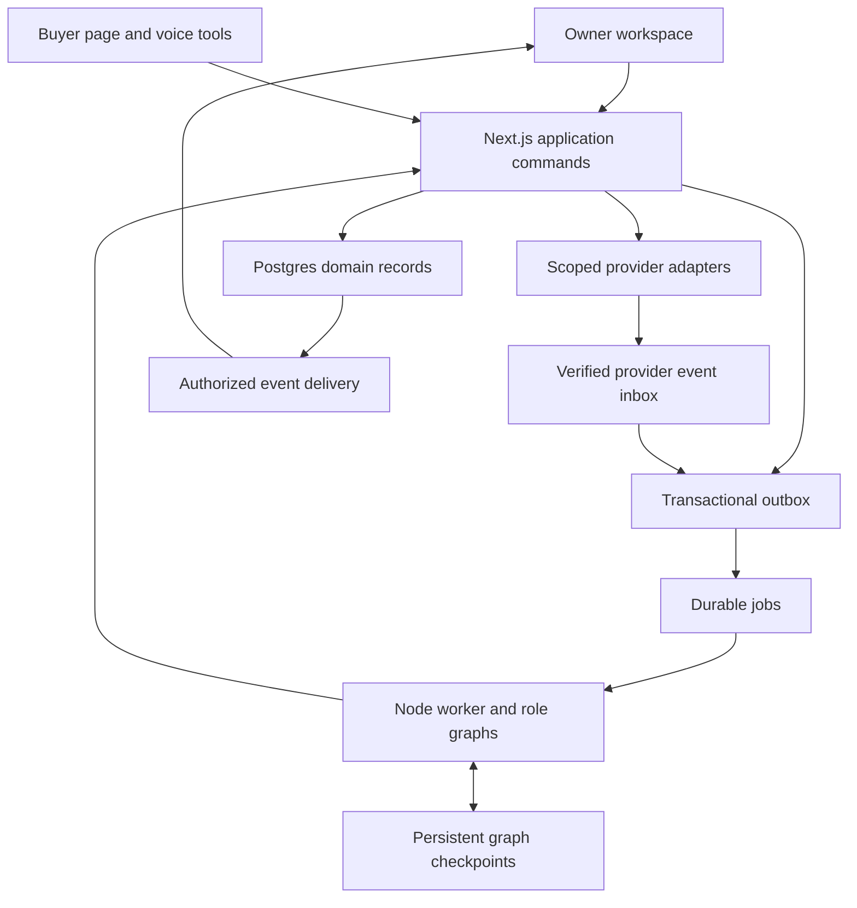

# System Architecture Document

**Version:** 1.0, 16 October 2026, Asia/Jakarta.  
**Scope:** Full working application, with a bounded first integrated release.  
**Naming:** Crewmori is a proposed working name. Principal is the historical name. Final naming remains open.  
**Implementation status:** Specification only. See `BUILD_STATUS.md` for actual build status.

## 1. Architecture decision

Use one TypeScript repository containing a web application and a durable Node worker. Divide the code into domain modules with explicit ownership. Six specialist agents run as separate bounded tasks in that application. They share approved business records and evidence, while retaining role-specific context, tools, budgets and artifacts.

The initial deployment has three main resources: a web process, a worker process and managed Postgres/auth/private storage. Choose supported versions and deployment settings during setup. Builder skills, staffing, hours and budget are builder-managed details; they are not reasons to repeat the founder intake.

The public buyer surface, owner-private workspace and restricted operator controls have different authorization scopes. A payment sandbox is an executable test boundary, not a production settlement claim.

## 2. Components and data flow

“Application commands” are shared domain functions, not necessarily internal HTTP calls. Worker, browser routes and voice tools invoke the same implementation. Do not create a second financial authority inside the voice provider or an automation platform.

| Component | Recommended implementation | Responsibility |
|---|---|---|
| Web | Next.js, React, TypeScript | Owner/buyer interfaces, authenticated routes and public projections |
| UI | Accessible primitives, custom agent assets and semantic focus anchors | Six-agent dock, inspector, work artifacts and approval controls |
| Domain | Typed TypeScript services with Zod contracts | Commercial, capacity, payment, CRM and authorization rules |
| Worker | Long-running Node process | Bounded background jobs, graph execution and recovery |
| Job queue | pg-boss | Claiming, leases, retry scheduling and delayed work |
| Agent graphs | LangGraph.js and persistent Postgres checkpointer | Role task progression and owner intervention |
| Persistence | Supabase Postgres/Auth/private Storage | Business truth, membership, protected files and activity |
| Retrieval | Postgres full-text; optional pgvector hybrid search | Source-linked owner/audience-scoped evidence |
| Model | One configured tool-calling provider | Interpretation, clarification, drafting and allowed tool choice |
| Voice | ElevenLabs initially | Managed conversation transport and speech interface |
| Realtime | Supabase Realtime plus durable event replay endpoint | Task/character/cursor updates with recovery after reconnect |

Provider alternatives and prerequisites live in `04_INTEGRATIONS.md`. The earlier technical plan's documentation register is included in `reference/AI_Business_Team_Technical_Plan.md`.

## 3. Domain modules and ownership

| Module | Owns | Must not do |
|---|---|---|
| Identity | Workspace membership, buyer grants, invitation exchange and connector consent | Trust a supplied workspace/engagement ID as authority |
| Profile/evidence | Approved capabilities, service policies, source versions, chunks and visibility | Convert retrieved instructions into permissions |
| Acquisition | Source records, opportunity evidence, campaigns, attribution and suppression | Treat inferred need as an explicit request or send automatically |
| CRM | Clients, engagements, relationship timeline and next actions | Infer retention from a follow-up draft |
| Conversation | Session mapping, final messages, requirement versions and summaries | Treat a generated recap as buyer acceptance |
| Commercial | Computed options, immutable offers, approvals, acceptance and amendments | Permit model-invented binding prices |
| Capacity | Availability windows, reservations, expiry and allocations | Allocate the same available minutes twice |
| Payments | Issued invoice snapshots, requests, receipts, allocations and reconciliation | Let provider adapters define different balance rules |
| Agents | Role definitions, tasks, runs, context, tool allowlists and budgets | Change its own scope or bypass domain commands |
| Events/operations | Outbox/inbox, activity ordering, costs and recovery | Announce success before its durable postcondition |

## 4. Agent execution model

Each of Scout, Promoter, Sales, Account Manager, Operations and Finance has a distinct role definition, context builder, allowed tools, output schema and task/run identity. One foundation model can serve every role. Separate models or services are not required.

The supervisor handles goal interpretation, task dispatch and handoffs. Use deterministic routing for known lifecycle events. Use a model when the owner's goal needs interpretation. Independent runs can overlap; dependent runs join only when their input versions match.

Example: Scout reviews an imported request while Promoter drafts a campaign. Sales captures buyer requirements. Operations and Finance analyze that requirement version. The commercial service checks both outputs before creating an offer draft. Account Manager consumes accepted commitments and checked payment events.

### Dispatch and resume

1. An authorized command stores a task and outbox entry atomically.
2. The relay publishes a deduplicated job. Queue delivery can repeat; domain effects remain idempotent.
3. The worker loads current input versions, run control state and budget reservation.
4. The role graph executes a bounded segment, checkpoints and saves validated outputs.
5. A human clarification/approval ends the active segment and releases the worker.
6. An authenticated resume reuses the thread ID, reloads current business records and rechecks versions/authority.

pg-boss owns job dispatch/leases/retries. LangGraph owns within-run state. Do not add a second scheduler that competes for the same run. Serialize resumes for a thread. Checkpoint replay can repeat code before an interrupt, so consequential side effects require their own idempotency records and a separate authorization gate.

Initial policy proposals: two simultaneous role runs per workspace, eight tool steps per run, 1,500 maximum output tokens per model call, 180 seconds active time per segment and two safe transient retries. Budgets aggregate across segments/retries; concurrent agents reserve cost atomically. Actual monetary caps are configured by the builder/operator before dispatch.

### Control semantics

Pause prevents future dispatch at a safe boundary. Cancellation persists across retries and stops future effects. Redirect increments control version and refreshes context. Consequential commands receive the server-resolved run/control version and recheck it immediately before dispatch. An external effect already sent remains an effect and needs its own recovery state; cancelling a card does not undo it.

## 5. Persistence model

Domain records are authoritative. Checkpoints track execution position. Retrieval returns evidence. None may silently replace an accepted commercial record with an old model-memory value.

| Record group | Required integrity |
|---|---|
| Workspaces/memberships | Membership and RLS scope, separate buyer access grants |
| Profile/service versions | Approved claims, policy version and owner confirmation |
| Sources/chunks | Source hash/version, audience, provenance, timestamps and extraction status |
| Campaigns/opportunities | Import/live/demo mode, native ID/URL hash, attribution and suppression |
| Clients/engagements | One continuing relationship record linking artifacts and agreements |
| Conversations/messages | Provider mapping, final-message deduplication, audience and requirement version |
| Artifacts | Output type/schema, creating run, input versions and evidence refs |
| Offers/approvals/acceptances | Immutable material snapshot/hash, actor, expiry and amendment history |
| Capacity | Window minutes, reservation state and transactional allocation |
| Invoices/payments | Accepted offer reference, immutable issued totals, unique events, receipts and allocations |
| Tasks/runs/jobs | Role identity, lifecycle, thread ID, controls and bounded attempts |
| Activity/outbox/usage | Durable sequence, redacted outputs, replay and actual/estimated costs |

Logical records need not each become a separate table. Settings and low-risk artifacts may start in JSONB. Preserve distinct constrained records where tenant scope, acceptance, reservations, payment uniqueness or allocation requires them. Define ownership, unique keys and indexes in migrations before exposing mutation routes.

### Separate lifecycles

Engagement, offer version, payment request, reconciliation, capacity reservation, publication and professional delivery each have their own state machine. A deposited engagement can be active while professional work remains unfinished. Several payment attempts can belong to one invoice without overwriting earlier receipts. The state vocabulary is centralized in `03_API_AND_DATA_CONTRACTS.md`.

## 6. Commercial consistency and financial commands

The offer service computes permitted packages using decimal/minor-unit arithmetic. It consumes capability, capacity, required expenses, deposit limits, documented fees/FX, acquisition costs and route prerequisites. Unknown required facts remain unknown.

Owner approval and buyer acceptance reference an immutable offer hash covering scope, amount/currency, deposit, delivery date/timezone, beneficiary, route, quote and relevant assessment/policy versions. Material changes produce a new offer or amendment. Every acceptance remains historical truth even before payment. An unrelated profile-photo edit does not invalidate all offers.

Acceptance is transactional: verify grant and current offer/approval; lock capacity windows in stable order; reject conflicts; persist acceptance and provisional reservation; write the next-action outbox. An amendment reallocates the delta against the existing reservation under the same consistency rules.

The initial unpaid-hold proposal is 30 minutes, disclosed before acceptance. Reconciled deposit commits the reservation. Cancellation/expiry releases it. If payment arrives after release, preserve the money record and route capacity recovery to the owner; do not silently promise unavailable work.

Payment-request dispatch requires a fresh route assessment with `satisfied` status. `blocked` and `unknown` prevent dispatch. This only establishes configured prerequisites, not universal provider approval or settlement.

`PaymentAdapter` creates requests, checks status, verifies events and normalizes provider facts. The Payments domain matches invoices, allocates gross credit, calculates balances and commits capacity. Save every verified receipt; mismatches/partial/overpayments remain unapplied or review-required. Gross invoice credit, fees and net cash are different quantities.

## 7. Voice, retrieval and audience boundaries

The voice host is an adapter to Sales. It uses the same commands as text and dashboard routes. Backend-issued session credentials bind provider calls to a canonical conversation and authorized buyer grant. Supply only buyer-safe context. Client-side tools can navigate/focus UI; durable business writes remain server-side.

Long analysis returns a pending task reference. The representative retrieves a completed public result before announcing it. Persist final transcript segments with provider IDs/timestamps and deduplicate retries. Preserve structured amounts, currencies, dates/timezones, conditions and acceptance separately from generated English/Indonesian recaps.

A public campaign visitor can create a new isolated inquiry. A campaign token cannot reveal an existing client's record. Existing-client access uses a verified, expiring invitation exchange and an engagement-scoped session. Verify intended contact identity before a consequential real pilot flow. The pilot's actual identity method is configured by the builder.

Ingestion starts with confirmed service descriptions, approved portfolio facts and supported text/PDF formats. Keep source/page/offset references and source audience. Search authorization occurs before ranking. One embedding model/dimension/chunker version defines an index; changing it requires re-indexing. Add OCR or complex document parsing only when needed.

Use source-linked RAG to support claims. Use structured outputs to make artifacts parseable. Use application rules for authority and calculations. Public review sentiment is not a valid training label for conversion/default predictions.

## 8. Dashboard activity, cursors and recovery

Persist meaningful activity with workspace/run/task/role, sequence, event type, semantic focus target and concise outcome. Map targets such as `offer.deposit` to actual rendered elements. Do not persist desktop pixel coordinates as the source of truth.

Live delivery is a notification channel. On reconnect the UI deduplicates by event ID, queries events after the last sequence and reloads a snapshot after gaps. Generate an ordered per-workspace sequence under a workspace lock at the initial scale. The chosen mechanism can evolve after measured load justifies it.

All six characters remain visible; only a few need moving cursors. Show named focus, saved outputs, waiting questions and review controls. Cursors should point to actual tool/evidence/artifact actions. The old Stitch files illustrate mock states; the working app must connect these states to real durable events.

## 9. Security and operations

Keep all vendor/database service secrets server-side. RLS protects owner-accessible records, files and event subscriptions; privileged worker credentials still require explicit workspace/action checks. Validate schemas and use parameterized queries. Treat source text as untrusted and render it safely.

Protect URL import from private/link-local destinations and redirect bypasses. Restrict upload types/size and separate extraction from public requests. Authenticate tool/webhook calls and verify raw signatures before persisting a deduplicated inbox event. Redact secrets and sensitive data in traces.

Use appropriate browser session/CSRF/origin controls. Invitations, signed storage links and connector tokens need expiry/revocation. Default raw audio off; define configurable transcript/checkpoint retention and deletion across storage, chunks/embeddings and supported provider data.

Operator recovery includes inspecting dead-letter jobs, resuming a task, reconciling a pending request, seeing unapplied cash and revoking a connector. A timeout after external submission is unknown/pending until reconciled. Do not blindly retry possibly completed effects.

## 10. Deployment and acceptance

Run the worker on a persistent process host. Web and worker share contracts/domain code and compatible pinned dependencies. Store database/queue/checkpoint schemas under controlled migrations. Use Node-compatible routes for libraries requiring that runtime. Do not depend on an HTTP invocation staying alive to finish an agent goal.

Before calling the first release functional, prove the complete text journey, then the same business commands through live voice, with two genuine concurrent roles, correct offers, explicit acceptance, atomic capacity allocation, replay-safe sandbox receipt and Account Manager follow-up. Verify tenant/buyer isolation and recovery. `08_VERIFICATION_AND_RELEASE.md` owns the executable acceptance checklist.

This SAD is the current architecture baseline. Detailed field/event/API contracts live in `03_API_AND_DATA_CONTRACTS.md`. Historical proposals in `reference/` supply rationale and documentation links but do not override this package's canonical documents.
