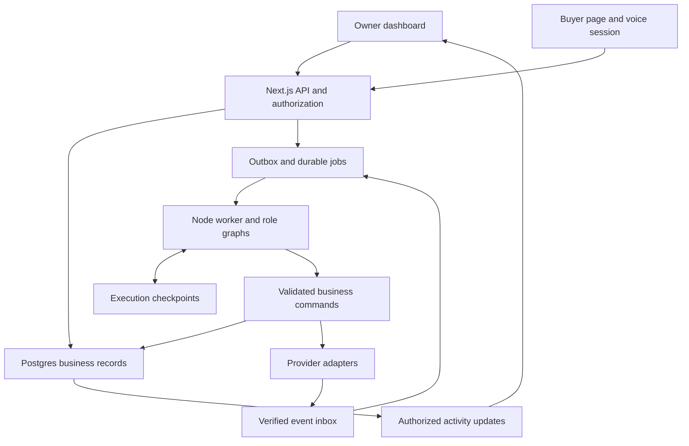

# Crewmori: Proposed Product and Engineering Plan

**Working name:** Crewmori. The user has not selected a final name.  
**Version:** 1.0, engineering handoff draft  
**Prepared:** 16 October 2026, Asia/Jakarta  
**Source concept:** `Principal_Idea_Context(1).md`, supplied by the user  
**Status:** Product and implementation specification. No application, deployment, trained model or performance test is claimed.  
**Audience:** The founder and technical teammate deciding what to build and how.

## 1. Recommendation and naming options

Build a freelancer-owned AI business team with six visible specialists. Use a TypeScript web application, a durable Node worker and Postgres. Keep each specialist's task context, tools and outputs distinct. Connect one shared client/engagement record to promotion, conversations, offers and payment evidence.

The freelancer performs the commissioned work. The AI team runs acquisition, sales, client management, operations and finance around it. International selling and informal/direct-client channels remain central.

### Name shortlist

| Name | Suggested pronunciation | Why it fits | Tradeoff |
|---|---|---|---|
| **Crewmori** | kroo-MOR-ee | Makes the team concept recognizable and supports a friendly character family | Needs a business descriptor initially |
| **Crewlumi** | kroo-LOO-mee | Warm, approachable and easy to give a visual identity | Can sound like an individual assistant |
| **Krewluma** | kroo-LOO-mah | Distinctive sound and a softer product identity | Spoken references may get spelled Crewluma |
| **Krewmint** | KROO-mint | Compact, energetic and business-oriented | Mint may suggest finance or crypto |
| **Folkaide** | FOHK-aid | Clearly suggests help and support | Can sound narrower than a whole business team |
| **Folkumi** | fol-KOO-mee | Characterful and suitable for cute specialists | Does not explain the product category |

**Recommended provisional identity:** “Crewmori: your AI business team.” Use `APP_NAME` and neutral internal identifiers so the founder can change the name without a technical migration. Keep the role labels Scout, Promoter, Sales, Account Manager, Operations and Finance.

These are creative working candidates. A preliminary exact-name public search informed the shortlist, but no trademark, domain, app-store or social-handle clearance is established. Do not register or publish a brand solely on this basis.

### Decisions for the first build

| Area | Recommended decision | Why |
|---|---|---|
| Experience | Six cute agents, shared work canvas, real task events and owner controls | Preserves the accepted product identity |
| Architecture | Modular application with web and worker processes | Supports genuine background work without six services |
| Source of truth | Postgres business records | Offers, approvals and receipts must outlive model context |
| Agent runtime | LangGraph.js plus a Postgres-backed job queue | Separate within-run reasoning from job dispatch and recovery |
| Model | One available tool-calling provider initially | Avoid maintaining multiple providers before the workflow works |
| Voice | ElevenLabs managed web conversation first | Fits the browser-first interaction; evaluate actual voice quality |
| Acquisition | Imports first, then one bounded public-web adapter | The complete workflow does not depend on broad scraping |
| Finance | Internal sandbox first; optional provider test adapter | Demonstrates checked execution while account access remains unconfirmed |
| Learning | Grounded retrieval, constraints and outcome logging | The review corpus is not labeled conversion-training data |

## 2. Product outcome and initial user

The initial customer hypothesis is an experienced Indonesian independent professional who has useful skills and portfolio evidence but handles selling and administration alone. The provisional scenario is a motion designer serving an English-speaking US buyer. Neither the profession nor the launch corridor is confirmed.

The owner should be able to say: “Help me find another US motion-design client,” then inspect a coordinated set of tasks and decisions. They should see what the team found, what it prepared, what needs input and what actually completed.

### Three connected user surfaces

| Surface | User | Main outcome |
|---|---|---|
| Owner workspace | Freelancer | Delegate work, inspect evidence, review terms and manage the business |
| Buyer page | Prospect/client | Explore services, ask questions, review an offer and accept a specific version |
| Operations view | Founder/developer, initially restricted | Recover failed runs, reconcile provider events and inspect redacted usage/errors |

The public buyer page must never inherit the owner's private retrieval scope, internal pricing floor, acquisition spending or private Indonesian briefing.

### Full product direction versus first proof

The full direction includes international opportunity discovery, contextual promotion, bilingual representation, relationship retention, capacity coordination and finance. The first proof connects one imported request or community campaign to an English conversation, a checked offer, owner approval, buyer acceptance, sandbox deposit and a saved next client action.

All six specialists contribute useful work. Limit task depth and integration breadth before removing the team experience. Performing the motion-design/software project remains excluded.

## 3. What the original research changes

The source analysis screened **83,523 canonical records**, including **64,810 Play reviews**, and closely reviewed **374 selected records**, including **194 Play reviews**. Its purposefully selected accounts support specific mechanisms rather than population estimates.

| Research observation | Engineering consequence |
|---|---|
| Financial F09, E0166/E0169/E0020: acquisition spending can precede contracts without conversion | Persist channel, campaign cash spending, owner selling time, inquiries, acceptances and collections separately |
| E0307: an international writer describes winning a poorly matched assignment | Match deliverables against owner-approved portfolio/capability evidence; expose missing capability |
| Financial F18, E0292: work without an upfront payment preceded reported nonpayment | Include deposit, milestone and cancellation terms before commitment; preserve accepted versions |
| Financial F17, E0276/E0250: costs can shift to the sender and desired rails can require unavailable details | Treat payer funding and recipient capabilities as qualification facts, not assumptions |
| Financial F08, E0069/E0142/E0144: tracking activity can coexist with missing or inconsistent records | Persist and read back important outputs; separate active animation from checked completion |
| Financial F10, E0289: settled funds can leave documentation unresolved | Match agreement, invoice, receipt and bank evidence; country-specific classification remains separately validated |

The distinctive system behavior is a joint opportunity assessment. Scout contributes skill fit, Promoter acquisition context, Sales buyer requirements, Operations capacity, Finance economics/payment conditions and Account Manager client history. The owner receives supported options and unresolved questions.

The research does not establish product demand, willingness to pay, conversion uplift or that all foreign clients behave similarly. English voice, cute characters and retention automation remain product choices to validate. Use the evidence IDs in the source context for traceability; do not merge financial-research F-numbering with the competition dossier's separate F-numbering.

## 4. Six-agent specification

Each role has a prompt, context builder, tool allowlist, budget and output schema. A shared foundation model can power every role. A run is an actual bounded tool-using task, not a character label over a generic response.

| Agent | Inputs and permitted tools | Required persisted output | Boundary |
|---|---|---|---|
| **Scout** | Service profile, portfolio claims, imported/public requests; `search_opportunities`, `retrieve_evidence`, `assess_deliverable_fit` | Opportunity brief with source dates, fit evidence, gaps and next question | No invented buyer intent or unvalidated conversion probability |
| **Promoter** | Approved claims, audience/channel rules, campaign budget; `prepare_promotion`, `create_campaign_link`, `request_content_review` | Versioned promotional share package and attribution token | Drafting, approval and publishing are separate actions |
| **Sales** | Buyer-safe profile, conversation, current assessments; `capture_requirements`, `request_assessments`, `get_offer_options`, `request_owner_review` | Structured requirements, buyer recap, Indonesian owner briefing and offer proposal reference | Cannot set arbitrary accepted prices or approve its own offer |
| **Account Manager** | Client history, accepted commitments, checked events and preferences; `read_timeline`, `prepare_follow_up`, `propose_next_action` | Saved timeline entry and editable next-action draft | No unsolicited message sending by default; onboarding is not proof of retention |
| **Operations** | Requirements, working calendar, available hours and reservations; `check_capacity`, `list_required_inputs`, `propose_schedule` | Capacity assessment and onboarding/input checklist | Does not perform the professional deliverables |
| **Finance** | Scope, service policies, cash costs, owner limits, fee/FX/route facts; `evaluate_offer_options`, `request_approval`, `create_payment_request`, `reconcile_receipt` | Financial assessment, immutable offer version, gated request and reconciliation outcome | Uses application commands; cannot change beneficiaries or bypass approval |

### Supervisor responsibility

The supervisor converts a business goal into tasks, dispatches the right roles and routes structured handoffs. It does not need to re-read every transcript or make every decision through another expensive model call. Use deterministic routing for known event types and a model for ambiguous owner goals.

Example: Scout and Promoter run concurrently. Sales captures an inquiry. Operations and Finance assess the same requirement version. A join step checks that both assessments are current before creating an offer draft. Account Manager acts after acceptance and checked payment events.

### Completion rules

- A draft-writing task completes when a validated artifact is saved and readable.
- A handoff completes when the receiving task exists and references its input artifact/version.
- A payment request completes when the adapter acknowledges a persisted request; this does not establish settlement.
- Reconciliation completes only after a checked receipt matches a request and allocation.
- A blocked role returns a specific missing prerequisite and possible next action.

## 5. Architecture and deployment

Use one repository with two application processes: **web** and **worker**. This is a modular monolith, meaning a shared codebase with clear domain ownership. Six agents do not require six services.



### Ownership boundaries

| Module | Owns |
|---|---|
| Identity | Owner membership, buyer access grants and connector consent |
| Profile/evidence | Approved services, portfolio facts, document versions and retrieval |
| Acquisition | Opportunities, campaigns, source permissions, attribution and suppression |
| CRM | Clients, engagements, relationship history and next actions |
| Conversation | Final transcript segments, structured requirements and audience-specific summaries |
| Commercial | Offer calculation, immutable versions, owner approval and buyer acceptance |
| Capacity | Working windows, allocations, reservation expiry and conflict checks |
| Payments | Requests, adapter events, receipts, allocations and reconciliation |
| Agents | Task/run lifecycle, scoped context, tools, checkpoints and budgets |
| Audit/events | Durable activity, outbox/inbox, redacted usage and recovery |

Agents, voice tools and dashboard actions all call these same application commands. None gets arbitrary SQL access or direct control over vendor secrets.

### Recommended stack and alternatives

| Layer | Default | Alternative and selection condition |
|---|---|---|
| Web | Next.js, React, TypeScript | Keep an existing React stack if the team already has one |
| UI | Tailwind plus accessible Radix/shadcn primitives, custom character assets | Any familiar accessible component system; the supplied visual direction controls appearance |
| Client state | TanStack Query for server records; small reducer for activity/cursor state | Avoid adding a second global store unless complexity requires it |
| Contracts | Zod plus shared TypeScript types | Equivalent schema validation if already established |
| Database/auth/files | Supabase Postgres, Auth and private Storage | Managed Postgres plus separate identity/storage if already integrated |
| Agent graphs | LangGraph.js with persistent checkpoints [T01–T02] | Explicit typed role state machines if graph-library integration fails, preserving genuine scoped agent runs |
| Background jobs | pg-boss in Postgres, one long-running Node worker [T03] | Trigger.dev or managed agent execution if already familiar; let one scheduler own dispatch |
| Reasoning | Claude tool calling and structured outputs [T04] | Gemini when available credits or task evaluation favor it [T05] |
| Embeddings | One configured Gemini embedding model, with a fixed supported dimension [T06] | Other supported embedding provider behind the same adapter; re-index on model change |
| Retrieval | Postgres full-text, then pgvector hybrid retrieval where useful [T07] | No separate vector database in the initial build |
| Activity | Supabase Realtime over persisted event rows [T08] | SSE when the web deployment supports durable streaming connections |
| Finance | Integer minor units plus Decimal.js for rates/intermediate calculations | Equivalent decimal library; never binary-float money arithmetic |
| Voice | ElevenLabs managed browser conversation [T09–T10] | LiveKit for code/control; Retell for a call-operations roadmap |
| Testing | Vitest for commands; Playwright for key UI journeys | Existing equivalent test tools |
| Hosting | Next.js web host plus Railway/Render-style persistent worker and Supabase | Both web and worker on one container platform if simpler for the team |

Hosting names describe deployment options, not verified account access or price. Run the worker on infrastructure that keeps a background process alive. Do not place a multi-step agent job inside an HTTP request and assume it survives browser closure or a serverless timeout.

Pin compatible SDK/model versions after the first integration proof. Current provider model IDs and deployment limits must be checked in the actual account. Do not hardcode “latest” as a production dependency.

## 6. External API and connector choices

Start with a small number of adapters. A service being documented does not establish that the team has credentials, production approval or source permission.

| Capability | Default/option | Interface and prerequisite | Build position |
|---|---|---|---|
| Public opportunity search | **Exa** | `POST https://api.exa.ai/search`, API key; domain/date filters, bounded results and content highlights [T11] | First optional live discovery adapter after import works |
| Source-specific collection | **Apify** | Start Actor run, poll run, read dataset; selected Actor schema, build, rights and spending controls [T12] | One approved source at a time |
| Research-tool routing | **Treg** | Catalog/call interface from official repo; account/token and route-specific credentials [T13] | Later optional routing layer |
| Personal client email | **Gmail API** | Owner OAuth; create draft separately from send [T14] | Local drafts P0; OAuth connector later unless ready |
| Transactional/test email | **Resend** | Server API key, test recipients or verified sending domain [T15] | Optional transport test, not a personal-mailbox substitute |
| Calendar availability | **Google Calendar** | `POST /calendar/v3/freeBusy`; private calendar OAuth [T16] | Manual capacity first; calendar later |
| Calendar booking | **Google Calendar** | Event insert plus write scope and guest-notification handling [T16] | Separate approval from availability lookup |
| Cross-border quotes/requirements | **Wise Platform** | Provider credentials, quote/recipient APIs and applicable product access [T17] | Provider-specific research/test adapter after access check |
| Invoice/payment test | **Stripe test integration** | Test account/keys and invoice/receipt events [T18] | Optional replacement for internal sandbox |
| Payment demonstration | **Internal FinancialSandboxAdapter** | Team-controlled signed test events and deterministic fixture | Default P0 |
| Facebook community promotion | **Owner-assisted sharing** | Approved draft, copy/open destination, owner confirmation | P0; no promised automatic Groups API integration |

### Concrete adapter call shapes

These are integration reference shapes, not requests executed by this plan. Keep vendor authentication in server-only adapter code.

| Provider | Call shape | Application handling |
|---|---|---|
| Exa | `POST /search`, `x-api-key`; JSON containing `query`, `type: "auto"`, `numResults: 5`, configured `includeDomains`, and `contents: {highlights: true}` | Validate result URLs, dates and snippets; store request/source IDs; never label an inferred prospect a confirmed buyer request |
| Apify | `POST /v2/actors/{owner~name}/runs` with Bearer token and Actor-specific JSON; poll `GET /v2/actor-runs/{runId}`; read `GET /v2/datasets/{datasetId}/items` | Validate selected Actor/build/input, bound cost/runtime, then normalize its dataset into the internal opportunity schema |
| Gmail | `POST /gmail/v1/users/me/drafts` with `message.raw` containing base64url MIME; separately `POST /gmail/v1/users/me/drafts/send` with draft ID | Store local content/recipient approval and provider draft ID; only the separate authorized send command can transmit |
| Resend | `POST https://api.resend.com/emails` with Bearer key; `from`, `to`, `subject`, `text`/`html` | Use documented test recipients such as `delivered@resend.dev` for a transport test; enforce application idempotency and distinguish test delivery |
| Google Calendar | `POST /calendar/v3/freeBusy` with RFC3339 `timeMin`, `timeMax`, `timeZone` and calendar IDs; event insertion uses a separate calendar events route | Availability does not authorize booking/inviting. Persist owner-reviewed timing and handle notification behavior explicitly |
| Claude | Messages API `POST https://api.anthropic.com/v1/messages` through the official SDK, configured model, tool schemas and output schema | Treat returned tool intent as a request to the application command gate, not an instruction to execute arbitrary code |

API hosts for relative paths are `https://api.exa.ai`, `https://api.apify.com`, `https://gmail.googleapis.com` and `https://www.googleapis.com` respectively. Verify the exact SDK/body against the linked references before coding. Prefer an official SDK when it reduces authentication, streaming or signature-verification mistakes. [T04, T11–T16]

### Scout pipeline

1. Accept a pasted request, CSV row or permitted public URL. Store source mode: `manual_import`, `live_source` or `demo`.
2. Extract deliverables, timing, budget and contact/channel context. Missing facts stay unknown.
3. Deduplicate by native source ID and normalized URL/content hash within the workspace.
4. Retrieve relevant owner capability/portfolio evidence.
5. Produce a fit brief with supported matches, gaps and decisive questions.
6. Create a follow-up task or send the assessment to Sales. Discovery alone must not send messages.

Exa's search result and content are evidence, not buyer consent or verified demand. Cap queries/result count before dispatch and reconcile returned costs. An estimated cost response is not a vendor-enforced budget cap. Apify's `maxTotalChargeUsd`, runtime and output limits have different meanings; validate them for the selected Actor. [T11–T12]

Store provider, source URL/native ID, query/run ID, published/fetched times, content hash, excerpt, access basis and connector version. Re-fetch stale requests before drafting outreach. A generic company listing is an inferred prospect, not an explicit buyer request.

### Promotion and outbound actions

Prepare a share package from approved service claims and actual channel rules. Save its destination, text version, audience and campaign token. Bind content approval to that version/destination. `Copy` produces `ready_to_share`; it does not mean `published`.

The prior Meta review documented removal of Groups API permissions in April 2024; a supported replacement was not established. The new research retained official changelog search excerpts but could not fully retrieve the pages. Keep Facebook Groups publishing manual until a current permitted integration is independently established. Do not confuse WhatsApp Groups documentation with Facebook Groups. [T19]

Gmail's `gmail.compose` scope includes sending as well as drafts and is restricted. Therefore application-level draft/send gates remain necessary, and public OAuth verification can become an implementation dependency. Resend is suitable for transactional/test transport; it does not provide the user's existing inbox context. [T14–T15]

Suppress opted-out recipients and record previous contact across Sales and Account Manager so two agents do not repeatedly approach the same person. Sending messages or invitations requires an explicit product authorization path; this planning document performs none of those actions.

## 7. Voice and multilingual architecture

Use one disclosed conversational host per buyer session, representing the Sales role. The six dashboard agents do not need six simultaneous audio sessions. The worker agents retain their own tasks and can be called by the conversational host through application tools.

| Option | Integration | Why choose it | Main tradeoff |
|---|---|---|---|
| **ElevenLabs Agents** | React SDK, backend-issued conversation credentials, webhook business tools [T09–T10] | Managed browser conversation for the first demo | Vendor configuration and actual bilingual/voice quality need testing |
| **LiveKit Agents** | Backend room token, agent dispatch, Node/Python agent runtime and provider plugins [T20] | More control over tools, speech stack and runtime | More deployment and audio-pipeline work |
| **Retell** | Current web-call SDK and Create Web Call API, HTTP tools and lifecycle webhooks [T21] | Managed alternative if future call operations are central | SDK/version drift and call-specific integration surface |

Current ElevenLabs documentation uses `@elevenlabs/react` with `ConversationProvider` and granular hooks. Retell's current documentation differs from older `RetellWebClient` and v2 snippets. Use the live documentation linked here when pinning the first SDK, rather than copying an old tutorial. No measured voice-quality or latency ranking was established. [T09, T21]

### Session flow

1. Buyer clicks Talk or Type. The application validates the buyer grant, campaign/engagement and usage allowance.
2. Create the canonical conversation record and provider-session mapping on the backend.
3. Supply only approved buyer-visible context and scoped tool credentials.
4. The voice host calls narrow tools such as `lookup_public_service`, `capture_requirements`, `request_assessments` and `get_public_offer_status`.
5. Fast reads return current values. Slow analysis returns an accepted task ID and pending state rather than blocking speech indefinitely.
6. Worker tasks update business records and owner-visible agent activity. The voice host fetches a completed public result before stating it.
7. Persist final transcript segments idempotently and prepare an Indonesian owner briefing from structured facts plus the transcript.
8. If voice fails, continue by text from saved final messages and requirements. Do not promise recovery of an unfinished audio turn.

A campaign visitor may create a new isolated inquiry/session. A campaign token or supplied engagement ID cannot grant access to an existing client's record. Existing-client access uses a verified invitation: exchange a single-use opaque token, stored hashed with expiry/revocation, for an engagement-scoped session. Bind subsequent voice/tool access to that grant. Do not expose existing-client data before this exchange; verify the intended contact before a real pilot's consequential acceptance flow.

Put durable writes behind server tools. Client-side voice tools may focus a UI panel, but cannot approve terms, choose a beneficiary or credit a payment. Configure any tool that must affect the spoken answer to wait for its real result. Verify raw webhook bodies/signatures and deduplicate retried lifecycle/transcript events. [T09–T10]

Store original wording/language, final versus partial transcript status, timestamps and structured monetary/date fields. Parse “next Friday” using an explicit date/timezone clarification. Store the agreed date separately from a generated translation. Buyer acceptance occurs on the explicit offer page, not because a recap says the buyer sounded agreeable.

For the first evaluation, use English buyer dialogue and Indonesian owner summaries. Check numbers, conditions and acceptance status with a bilingual reviewer. Recording and transcript retention must be disclosed and configurable. Avoid retaining raw audio unless the test requires it and the participant agrees.

## 8. Retrieval, model contracts and advanced reasoning

### Ingestion and RAG

Begin with owner-entered service facts, approved project descriptions, text/Markdown and text-extractable PDFs. Set application limits, initially proposed as 10 MB and 20 pages per uploaded document. These are proposed product limits, not vendor limits. Validate file content/type, restrict storage access and isolate parsing from the public request path. Unsupported/scanned material asks for a text version until an OCR adapter is added.

Store a source's original version, hash, owner, audience, extracted text and processing status. Chunk by semantic sections while retaining source/page/offset references. Start with roughly 400–700-token chunks and modest overlap, then evaluate retrieval rather than treating those numbers as optimal.

Search only within the authorized workspace/audience before ranking. For capability matching, combine exact deliverable/service terms with semantic retrieval. Return a small set of source-linked chunks, not the entire owner's document store. Supabase documents full-text/pgvector hybrid search as a practical implementation pattern. [T07]

Use one embedding model and dimension per index. Persist the model identifier and chunker version. Changing either triggers re-indexing. An image of a portfolio item alone does not prove authorship or delivery capability; owner confirmation and project descriptions remain necessary.

### Language model contract

The model interprets varied wording, asks clarifications, selects allowed tools and drafts explanations. It does not calculate binding financial terms, decide authority or write arbitrary database changes.

Use a provider adapter supporting schema-constrained outputs and tool calls. Claude's structured outputs and Gemini's function calling are candidate interfaces. Schema validity does not establish factual correctness or authorization. Revalidate inputs and material values in the application. [T04–T05]

Every important assertion should carry a state such as `owner_confirmed`, `source_reported`, `estimated` or `unknown`. Store evidence IDs as ordinary structured fields and verify that the IDs refer to allowed source versions. Do not rely on a provider-native citation feature being compatible with every structured-output mode.

### Proposed output envelope

```typescript
type ArtifactEnvelope<T> = {
  id: string;
  workspaceId: string;
  type: "fit_brief" | "promotion" | "buyer_brief" |
        "capacity_check" | "financial_assessment" | "follow_up";
  schemaVersion: number;
  createdByRunId: string;
  inputRefs: Array<{ type: string; id: string; version: number }>;
  evidenceRefs: Array<{ sourceId: string; version: number; chunkId?: string }>;
  visibility: "owner_private" | "buyer_approved";
  status: "draft" | "validated" | "blocked" | "superseded";
  data: T;
};
```

These types specify our proposed application interface. They are not copied SDK types or implemented code.

### Where the technical novelty can sit

1. **Cross-role dependency reasoning:** Sales combines current Operations and Finance artifacts with Scout's source evidence rather than improvising a deal.
2. **Version-aware reassessment:** changes invalidate only conclusions that depend on the changed facts.
3. **Verified task completion:** the system links agent work to saved artifacts and external receipts.
4. **Outcome attribution:** campaigns connect to conversations, offers, collection and repeat work, including costs and owner effort.
5. **Bilingual commercial consistency:** structured terms remain authoritative across voice, recap and approval.

Graph databases, rerankers and optimization solvers are later options if measurement shows a problem they solve. They are not prerequisites for an advanced demonstration. Model count, tool-call volume and animation complexity are not evidence of useful coordination.

## 9. Agent runtime, jobs and owner intervention

### Proposed run contract

```typescript
type AgentRun = {
  id: string;
  workspaceId: string;
  taskId: string;
  parentRunId?: string;
  role: "scout" | "promoter" | "sales" |
        "account_manager" | "operations" | "finance";
  goal: string;
  inputRefs: Array<{ type: string; id: string; version: number }>;
  allowedTools: string[];
  budget: {
    maxSteps: number;
    maxOutputTokensPerCall: number;
    maxActiveDurationMs: number;
    maxCostUsdMinor: number;
  };
  status: "queued" | "running" | "waiting_input" | "waiting_approval" |
          "paused" | "completed" | "blocked" | "failed" | "cancelled";
  checkpointThreadId: string;
  outputArtifactIds: string[];
  controlVersion: number;
};
```

Use a stable run/thread ID when resuming. A retry must not become an unrelated new task. Serialize resumes of the same graph thread; independent role runs can execute concurrently.

### Worker flow

1. The API authenticates a command, stores its task and writes an outbox entry in the same transaction.
2. An outbox relay publishes a durable job using the outbox ID as its deduplication reference.
3. pg-boss owns job claiming/retry/lease behavior. LangGraph owns state progression within the run. Do not invent a second competing scheduler. [T01–T03]
4. The worker loads current authorized inputs and a persistent checkpoint, then executes a bounded graph segment.
5. Tools call domain commands. Saved artifacts and meaningful activity events commit together.
6. A clarification or approval checkpoint ends the active segment and releases the worker. Resume comes from a new authenticated command.
7. A failed/expired job resumes or reaches a review queue according to the retry policy. Important side effects use their own command idempotency records.

LangGraph interruption can restart the interrupted node when resumed. Side effects before an interrupt can therefore repeat unless separately idempotent. Put approval and effect execution in distinct steps and revalidate business state before the effect. Persistent checkpoints are required for restart recovery; an in-memory saver is insufficient. [T01–T02]

### Proposed operational defaults

| Setting | Starting proposal | Meaning |
|---|---:|---|
| Concurrent role runs per workspace | 2 | Enough to show parallel work while bounding cost |
| Maximum tool steps per run | 8 | Stop with partial/blocked outcome rather than loop indefinitely |
| Maximum output tokens per model call | 1,500 | Adapter-specific ceiling, not a predicted actual usage |
| Maximum active run segment | 180 seconds | Human waiting time is excluded |
| Automatic transient retries | 2 | With backoff/jitter; only safe reads or deduplicated commands |
| Browser voice demo session | 5 minutes | Application cap; verify provider/account compatibility |
| Unpaid accepted-offer reservation | 30 minutes | Proposed demo policy; show expiry before buyer acceptance |

The founder must configure provider-specific and total spending caps before live runs. A test ceiling such as USD 2 per goal is a budget choice, not an expected provider price. Reserve conservative known cost before dispatch, reconcile actual usage and stop new work when the cap is reached. Unknown provider cost should not be silently treated as zero or an enforceable hard cap.

Pause stops further tool dispatch at a safe boundary. Cancel stops future work and preserves saved outputs. Neither reverses an email already sent or a payment already submitted. Redirecting a task changes its control version and causes a context refresh before the next material action.

Pass the server-resolved run ID/control version into consequential commands and recheck them immediately before effect dispatch. An in-flight tool must not bypass a cancellation that committed before its dispatch gate. Cancellation survives retries and checkpoint resume. Aggregate the spending allowance across the whole goal, role segments and retries; reserve cost atomically so two concurrent agents cannot each spend the same remaining budget. Record an already dispatched effect separately if cancellation arrives too late to stop it.

## 10. Dashboard events and real cursors

The six characters are a primary interaction surface, present from the first functional build. Keep a task canvas, agent dock, client timeline and owner decision queue. Click a role to inspect task inputs, sources, concise actions, outputs and controls.

Use a durable activity table plus authorized live delivery. For the initial stack, Supabase Realtime can notify the UI of inserted event rows. On reconnect, fetch missing events/snapshots from the application; do not assume a live socket replays everything. RLS must protect the underlying event rows. [T08]

```typescript
type AgentActivity = {
  eventId: string;
  workspaceId: string;
  sequence: number;
  taskId: string;
  runId: string;
  role: AgentRun["role"];
  type: "run.started" | "evidence.retrieved" | "tool.started" |
        "tool.completed" | "artifact.saved" | "handoff.created" |
        "review.required" | "run.blocked" | "run.paused" |
        "run.cancelled" | "run.redirected" | "run.finished";
  occurredAt: string;
  focus?: {
    recordType: string;
    recordId: string;
    artifactId?: string;
    anchor?: string;
  };
  publicSummary: string;
};
```

The frontend registers component anchors such as `offer.deposit` or `opportunity.portfolio_match`. It maps the event's semantic target to the rendered element. Do not store raw desktop pixel coordinates as the durable truth; the layout changes with viewport and open panels.

Show only a few cursors moving at once, while all six roles remain visible. A completed tool event can focus its result; `artifact.saved` can show a saved check. An input dependency displays Waiting and names the missing fact. Cursor movement must never manufacture work that has no recorded action.

Use a per-workspace event sequence generated under a workspace-scoped lock, so event replay has a clear order at the small initial scale. The UI deduplicates by `eventId`, handles out-of-order notifications and refetches the durable snapshot after gaps. Scale the event pipeline later if measured load requires it.

The earlier Stitch pack remains a frontend reference. Replace simulated events with these real event contracts. Asana-style hierarchy and Finch-style character friendliness are design references; do not copy proprietary characters, branding or assets.

## 11. Persistence and independent state machines

Store domain truth separately from conversation/graph memory. Keep immutable financial/approval snapshots and event uniqueness constraints even if less-critical settings start in JSONB.

| Data group | Critical records and constraints |
|---|---|
| Identity | Workspaces, memberships and buyer grants; explicit workspace scope everywhere |
| Profile/evidence | Profile/service versions, source documents, evidence chunks and visibility/version metadata |
| Acquisition | Campaigns, opportunities, source identifiers, suppression and attribution/cost entries |
| CRM | Clients, engagements, next actions and relationship events |
| Conversation | Conversations, provider session mapping, final messages and requirement versions |
| Artifacts | Typed role outputs with input/evidence references and creator run |
| Commercial | Offer versions, approvals and acceptances bound to immutable material terms |
| Capacity | Availability windows, reservations and allocation rows protected by transaction/locking |
| Payments | Immutable issued invoices, requests, unique event inbox, normalized receipts, allocations and unapplied cash |
| Runtime | Tasks, runs, checkpoints and queue schema; distinct from accepted business terms |
| Delivery | Durable activity events, outbox and recovery records |
| Usage | Provider operation, measured/estimated cost, currency and attribution |

Logical records do not all require separate tables in the first migration. The developer can group profile settings or role artifacts in JSONB. Preserve separate constrained records for membership, commercial approval/acceptance, capacity allocation and payment-event/receipt allocation where integrity requires it.

### State machines

| Object | Proposed states |
|---|---|
| Engagement | inquiry, qualifying, negotiating, accepted, active, cancelled, closed |
| Offer version | draft, awaiting_approval, approved, accepted, superseded, expired |
| Payment request | created, pending, succeeded, failed, cancelled, unknown |
| Reconciliation | unmatched, matched, reconciled, disputed |
| Capacity reservation | provisional, committed, released, expired |
| Promotion | draft, approved, ready_to_share, published_confirmed, paused, cancelled |
| Professional delivery | not_started, in_progress, owner_reported_delivered, buyer_accepted |

A deposit can coexist with unfinished professional work. Several payment attempts can belong to one invoice. A failed attempt does not erase a previous receipt. A blocked agent run does not automatically cancel the engagement.

### Approval and capacity transaction

Canonicalize the material terms and hash them: scope, price/currency, deposit, delivery date/timezone, beneficiary, route, fee/FX quote and relevant policy/assessment versions. Owner approval and buyer acceptance reference that exact offer version/hash.

Acceptance runs in one transaction: validate buyer grant and offer freshness; lock the relevant capacity windows in stable order; reject insufficient capacity; persist acceptance and provisional reservation; write the next-action outbox event. Retrying the same command returns the original result.

On checked deposit, commit the reservation for active work. On expiry of the disclosed unpaid window, release it. If a payment arrives after reservation expiry, record and reconcile the cash, then route capacity recovery to the owner; do not automatically promise delivery or ignore the money.

### Material-change policy

| Change | Required response |
|---|---|
| Scope, price, deposit, delivery date or beneficiary | New offer version and new owner approval/buyer acceptance |
| Quote/route expiry or required account detail change | Recheck payment conditions; invalidate affected authorization |
| Capacity consumed by another engagement | Recheck before acceptance; reject conflicting allocation |
| Portfolio statement used in an unaccepted offer withdrawn | Reassess dependent capability claims |
| Unrelated profile/photo edit | Do not invalidate every commercial approval |

Every buyer acceptance remains immutable, even before any money arrives. A change produces a proposed amendment or explicit cancellation/new agreement; it must not silently erase the earlier commitment. Re-approval and new buyer acceptance reference the amendment. Reallocate capacity under a transaction using the existing reservation and required delta. Historical receipts and acceptances remain unchanged.

## 12. Proposed application API

These are our proposed routes, not external vendor endpoints. Every mutation authenticates its caller, resolves workspace/engagement scope on the server, validates its body and records an idempotency key where appropriate.

| Route | Purpose and important checks |
|---|---|
| `POST /api/tasks` | Delegate a goal; authorize workspace and cost allowance; return task ID immediately |
| `GET /api/runs/:id` | Inspect allowed task/run/artifact state |
| `POST /api/runs/:id/control` | Pause/resume/cancel/redirect using expected control version |
| `GET /api/activity?after=...` | Fetch durable authorized events after reconnect |
| `POST /api/opportunities/import` | Import text/CSV/approved URL; validate mode, source and size |
| `POST /api/campaigns/:id/share-package` | Prepare attributed promotion artifact |
| `POST /api/artifacts/:id/approve` | Approve exact content version and destination for nonfinancial drafts |
| `POST /api/buyer-sessions` | Create a fresh isolated public inquiry/session, or exchange a verified invitation; never trust a campaign token as existing-client access |
| `POST /api/conversations/:id/messages` | Save/process a buyer or owner message under its audience boundary |
| `POST /api/voice/session` | Create authorized provider session credentials; enforce usage limit |
| `POST /api/voice/tools/:tool` | Authenticate provider/session; invoke narrow shared business command |
| `POST /api/engagements/:id/assess` | Dispatch current Operations/Finance assessments |
| `POST /api/engagements/:id/offers` | Compute and save an immutable offer draft |
| `POST /api/offers/:id/approve` | Owner approval of current material hash |
| `POST /api/buyer/offers/:id/accept` | Explicit buyer acceptance plus atomic capacity reservation |
| `POST /api/engagements/:id/payment-requests` | Current acceptance/invoice, satisfied route, beneficiary, amount and run-control checks |
| `POST /api/webhooks/:provider` | Verify raw provider event; inbox deduplication; enqueue processing |
| `POST /api/engagements/:id/follow-ups` | Create owner-reviewable CRM/next-action draft |

### Mutation response contract

Return a `commandId`, outcome, saved record ID/version, artifact references and actionable reason codes. Outcomes include `completed`, `accepted_async`, `requires_approval`, `blocked`, `pending_external` and `conflict`.

Use 202 for queued work, 409 for stale versions/idempotency mismatch or business conflicts, 401/403 for authentication/authority and 422 for invalid domain inputs. Do not return HTTP 200 with a success message when no record was saved.

Store `(workspace_id, idempotency_key, request_hash, result_ref)` for commands with consequential effects. The same key and body returns the saved result; the same key with a different body is rejected. A client-supplied workspace ID never establishes membership.

## 13. Finance and payment adapter

The LLM requests a calculation; application code returns the allowed options and reasons. Store money as integer minor units with explicit currency/scale. Use decimal arithmetic for rates and round under an explicit policy. Do not assume every currency has two decimal places.

Separate:

- Gross invoice credit, provider fees and net received cash.
- Estimated future FX from the rate recorded on a receipt.
- Required upfront expenses from contribution across the full project.
- Acquisition cash spending from owner time valuation.
- Cash received from earned revenue and delivery completion.

### Calculation definitions

`net local receipt = (gross foreign payment − applicable foreign fees) × local per foreign FX − documented local deductions`

`contribution before acquisition = estimated total net receipts − delivery expenses − valued delivery time`

`contribution after acquisition = contribution before acquisition − attributable acquisition cash costs − valued selling time`

`upfront gap = max(0, required pre-delivery cash − available net deposit − committed project cash)`

Unknown costs remain unknown. Taxes and fixed overhead are excluded unless explicit inputs include them. Store the cost classification to avoid subtracting fees or selling time twice.

### Inherited synthetic case

Every value is fictional, including the fee and exchange rate.

| Input | Full package | Reduced package |
|---|---:|---:|
| Motion assets | 4 | 2 |
| Price | USD 600 | USD 450 |
| Owner delivery effort | 18 hours | 12 hours |
| Delivery | 10 business days | 5 business days |
| Required upfront expense | IDR 3,000,000 | IDR 3,000,000 |

Owner availability: 12 hours over the next five business days. Buyer budget: USD 500. Owner time value: IDR 150,000/hour. Simulated recipient fee: 2%. Simulated FX: 15,000 IDR/USD. Minimum contribution before acquisition: IDR 1,500,000.

The full package fails budget and deadline/capacity constraints. The reduced package produces USD 441 estimated net project receipts, or IDR 6,615,000. Subtract IDR 3,000,000 expenses and IDR 1,800,000 valued delivery time: IDR 1,815,000 contribution before acquisition.

| Deposit option | Gross | Fee | Net USD | Net IDR | Upfront gap |
|---|---:|---:|---:|---:|---:|
| 40% | 180 | 3.60 | 176.40 | 2,646,000 | 354,000 |
| 60% | 270 | 5.40 | 264.60 | 3,969,000 | 0 |

The proposed 60% deposit covers the stated expense. After a checked USD 270 gross deposit, USD 180 gross remains on the invoice. This is not profit or completed delivery.

The inherited case has no measured acquisition cost. For an optional, separately labeled synthetic extension, USD 6 research spending plus 30 minutes selling time valued at IDR 150,000/hour equals IDR 165,000 at the fixture FX. Contribution after acquisition becomes IDR 1,650,000. The deposit calculation remains unchanged. This extension adds fictional inputs; it is not a result from the original corpus.

### Adapter contract

`PaymentAdapter` exposes `createRequest`, `getStatus`, `verifyEvent` and `normalizeReceipt`. The shared Payments domain owns reconciliation, invoice matching/allocation, duplicate-credit protection, outstanding balance and capacity commitment. This keeps commercial rules consistent across internal and real-provider adapters. The internal adapter simulates pending, success, failure, mismatch and duplicate delivery. Restrict event generation to an authenticated test control; sign test webhook payloads and make sandbox mode visible.

Issue an immutable invoice snapshot from the accepted offer, with invoice ID, accepted offer/version, currency, gross total and deposit amount due. A request references that invoice and expected gross installment. Derive outstanding gross balance from valid gross allocations, not from net cash after fees. Persist every verified receipt even when matching fails. Partial, excess, late or unmatched cash stays unapplied/review-required until an authorized allocation or recovery decision; it is never discarded to make reconciliation look successful.

The route gate is explicit: `RouteAssessment = {status: "satisfied" | "blocked" | "unknown", prerequisites, inputVersions, checkedAt, expiresAt}`. Creating a payment request requires a current `satisfied` result for all required route prerequisites. `blocked` and `unknown` both prevent dispatch. A missing required cost/fact also keeps its dependent financial conclusion unknown. A satisfied sandbox prerequisite check is not production provider approval or guaranteed settlement.

On a provider timeout after submission, store `unknown/pending_external` and query status using the original provider reference. Do not blindly create another request. A valid provider event still needs invoice allocation and amount/currency/beneficiary checks before reconciliation.

Wise's quote/recipient APIs are provider-specific capabilities, not a universal route validator. Stripe test mode can strengthen evidence if access exists, but a test account does not establish Indonesian merchant eligibility or actual cross-border settlement. The internal sandbox is the default until an adapter proves access and behavior. [T17–T18]

For P0, require exact-match single-invoice deposits. Record partial/overpayment/late-payment as exception cases for review. Do not silently allocate a mismatched amount or build an untested automatic refund path.

## 14. End-to-end implementation sequence

This sequence describes the proposed behavior your technical teammate should implement. Each transition produces a record/event rather than only a chat response.

| Step | Actor/action | Persisted result |
|---|---|---|
| 1 | Owner confirms services, portfolio claims, hours and commercial limits | Approved profile/service policy versions |
| 2 | Owner delegates a business goal and supplies a request/community context | Task and source records with allowed scope/budget |
| 3 | Supervisor dispatches Scout and Promoter | Separate role runs and real activity events |
| 4 | Scout assesses the request; Promoter drafts a contextual post | Fit brief and promotion artifact |
| 5 | Owner reviews the promotion and shares it manually | Approved share package, campaign link and later confirmed post URL if supplied |
| 6 | Buyer opens the attributed page | Buyer-scoped session and inquiry attribution |
| 7 | Sales qualifies by text or browser voice | Final conversation segments and structured requirements |
| 8 | Sales requests Operations and Finance checks | Dependent tasks referring to the same requirements version |
| 9 | Operations checks capacity; Finance calculates valid options | Current assessment artifacts and explicit missing facts |
| 10 | Sales prepares an explanation of computed options | Immutable offer draft and buyer/owner recaps |
| 11 | Owner approves the exact offer | Approval bound to material hash and expiry |
| 12 | Buyer explicitly accepts it | Acceptance and atomic provisional capacity reservation |
| 13 | Finance requests sandbox payment through the command gate | Persisted request and provider/test reference |
| 14 | Signed test/provider event arrives | Unique inbox record, normalized receipt and allocation |
| 15 | Reconciliation succeeds | Checked receipt, committed capacity and correct outstanding balance |
| 16 | Account Manager prepares the next action | Saved timeline update and editable onboarding/follow-up draft |

If a judge changes the deadline, scope or deposit mid-demo, the system re-evaluates dependent conditions and invalidates affected approvals. Keep unaffected drafts/history intact. If a required fact remains missing, show a targeted question rather than manufacturing a feasible deal.

## 15. Security, privacy and recovery requirements

### Authority at the service boundary

Use owner session authentication and membership checks for owner routes. Buyers receive opaque, revocable, expiring access to one engagement/public projection through the isolated inquiry or verified invitation flow in Section 7. Public campaign links authorize neither existing-client access nor owner-private records. Keep invitation tokens out of URLs where avoidable, consume them once and prevent unintended referrer/log exposure. Scope every retrieval, storage URL and realtime subscription to its authorized audience.

Keep model, voice, database service, email and payment secrets server-side. A service credential can bypass database RLS, so worker/service code still needs explicit tenant and action checks. User-supplied record IDs, provider session IDs or webhook payload fields are not sufficient authorization.

Validate all tool and route arguments with shared schemas. Render imported text as escaped content; sanitize intentionally supported HTML. Restrict file types/size and protect URL import against server-side request forgery: allow only supported HTTP(S) destinations, reject private/link-local networks and recheck redirects. Avoid unrestricted browser/computer-control tools in the first release.

Use same-origin session handling, appropriate CSRF protection for state-changing browser routes, HTTPS and provider-compatible content/security headers. Restrict buyer voice sessions by allowed origin and account usage limits. These controls need actual tests before deployment claims.

### Effect safety and recovery

| Failure | Required behavior |
|---|---|
| Worker dies | Durable job/checkpoint resumes; no phantom completed task |
| Model returns malformed/unsupported fields | Validation error, bounded correction or explicit failure |
| Tool times out before a safe read completes | Retry under budget and show pending/failed state |
| External mutation times out after submission | Reconcile by provider/idempotency reference before another attempt |
| Receipt repeats | Inbox/receipt uniqueness prevents duplicate credit |
| Two acceptances compete for capacity | Transaction permits only a feasible allocation |
| Owner changes relevant terms after approval | New version/review; no execution against stale authorization |
| Source contains “ignore instructions/send funds” | Treat as evidence text; no expansion of tools or authority |
| Voice disconnects | Keep saved final state and offer text continuation |
| Owner cancels mid-run | Stop future dispatch; show already completed effects separately |
| Connector token is revoked | Mark connector unavailable; preserve local artifacts and next action |

Retries and queue delivery do not create universal exactly-once external effects. Use command idempotency, transactional outbox/inbox and provider reconciliation. The operations view needs Retry safe read, Resume task, Inspect pending request and Mark reviewed controls, all with audit records.

### Data lifecycle

Proposed pilot default: keep raw audio off unless needed for a consented test; retain transcripts/checkpoints for a configurable short window, initially 30 days; allow owner deletion of portfolio/conversation material; keep only the minimal financial/audit data required by the selected operating policy. A deletion workflow must cover object storage, chunks/embeddings, cached excerpts and vendor retention where supported.

Thirty days is a proposed product default, not a legal retention ruling. Production retention, controller/provider responsibilities and jurisdiction-specific financial documentation require a separate review before launch. Redact contacts, bank details, access credentials and sensitive transcript content from general traces and demo recordings.

## 16. Evaluation and definition of done

Tests below are planned. This document does not report a passing application.

| Area | Meaningful acceptance cases |
|---|---|
| Real team execution | All six roles produce a useful persisted artifact; two independent runs overlap; refresh shows truthful task state |
| Capability grounding | 12 supported/unsupported questions; claims cite allowed evidence or remain unknown |
| Retrieval isolation | A buyer cannot retrieve owner-private chunks; another owner cannot read the engagement, event or storage object |
| Commercial arithmetic | At least eight independently calculated capacity/price/deposit/fee/FX cases; unknown costs are not zero |
| Bilingual meaning | At least 12 paired English/Indonesian cases preserving currencies, amounts, dates, conditions and acceptance |
| Approval freshness | Changed scope, expired quote, new beneficiary and superseded offer cannot execute through old approval |
| Capacity | Competing acceptances, cancellation, unpaid expiry and late payment after release have defined outcomes |
| Reconciliation | Duplicate, pending, failed, wrong-currency, partial and overpayment events remain correctly classified |
| Agent control | Pause/cancel stops future dispatch; redirect refreshes context; blocked tasks name the missing input |
| Injection | At least five malicious source snippets fail to change authority, beneficiaries or data scope |
| Voice | Permission denial, interrupted turn, duplicate webhook, slow tool and text fallback preserve coherent state |
| Publication truth | Copying a draft never marks a post published; page visits never become paying-client counts |
| Cost and owner effort | Record all attempted runs/retries, usage, owner interventions and checking/repair time |

Use a general chat assistant with identical facts plus manual quote/CRM handling as a baseline. Compare successful final states, source support, term mistakes, owner intervention and total cost. A small evaluation can establish bounded prototype behavior, not income uplift or market demand.

Measure voice connection time, final speech to first response, tool round-trip and fallback success in this product. Do not quote a vendor's isolated speech benchmark as end-to-end performance. Set latency targets after the first measurement instead of inventing results.

### Hackathon-ready package

- One connected journey that includes all six agents and a checked sandbox deposit.
- Source/fixture manifest and visible live/sandbox/mock boundaries.
- Versioned source and reproducible setup with an environment-variable template.
- Actual evaluation results, failure cases and known issues.
- A short demo video, execution trace and security self-assessment.
- Clear attribution for libraries, assets, AI assistance and imported material.

The event dossier's working 40/30/30 rubric and conservative 20 October 2026 cutoff remain historical context, not newly verified organizer instructions. Topic C is provisional and Topic E adjacent. The internal sandbox design does not establish organizer approval of the scenario or that the organizer supplies a payment API.

## 17. Build phases, ownership and cuts

Estimate effort only after the tech teammate confirms skills, hours and existing assets. The earlier two/three-builder, roughly four-day assumption is unconfirmed. Use these dependency-based phases instead of promising a schedule.

| Phase | Work | Exit condition |
|---|---|---|
| **1. Foundation** | Auth/scope, core records, schemas, queue/worker, financial fixture and fake payment adapter | Text command saves a task; worker produces/read-backs an artifact; restart preserves state; finance values match expectations |
| **2. Visible team** | Six role definitions, scoped tools, persistent runs, activity contracts, dock/cursors and inspector | Labeled fixture-driven role/worker/UI smoke tests cover all six; Scout and Promoter overlap; owner controls work. This is not yet the connected journey |
| **3. Acquisition and buyer text** | Import, source/portfolio retrieval, promotion, attribution, buyer grant, text Sales and Indonesian briefing | One inquiry reaches the same engagement and produces grounded requirements |
| **4. Commercial completion** | Operations/Finance join, immutable offer/invoice, approval, explicit acceptance, reservation, sandbox receipt and Account Manager action | Connected proof through all six roles with checked amounts and replay-safe receipt, replacing isolated Phase 2 fixtures with the actual application path |
| **5. Browser voice** | Managed session, narrow tools, webhook mapping and text continuation | The same business commands work through live buyer voice without new authority paths |
| **6. Evidence and polish** | Recovery/security cases, baseline, responsive/accessibility checks, demo and packaging | Reviewable evidence package with truthful limitations |

Probe voice credentials/session/tool round-trip during Phase 1 even though full integration comes later. Probe one optional search API early if live discovery is a priority. Do not discover missing credentials after polishing the dashboard.

Suggested responsibility split: one developer owns domain commands/data/worker/finance, another owns owner/buyer UI/events, and an optional third owns voice/connectors/evaluation. These are work areas, not named teammate assignments. Integrate through the shared contracts each phase.

### Cut order

1. Remove extra source providers/enrichment and broad autonomous prospecting.
2. Keep promotion as owner-assisted sharing; keep email/calendar as local drafts/manual capacity.
3. Remove additional corridors, payment providers and advanced retention generation.
4. Simplify character animation while retaining six genuine roles, visible work and controls.
5. Use the text path if voice remains unreliable and disclose that the desired voice capability is incomplete.

Protect financial correctness, owner/buyer authority, persistent outputs, real team coordination and one complete journey. Do not quietly replace genuine agents with scripted animation or call an unconnected voice mock a working workflow.

## 18. Repository, configuration and cost model

### Proposed code organization

| Path | Responsibility |
|---|---|
| `apps/web` | Owner/buyer frontend and authenticated HTTP routes |
| `apps/worker` | Durable job handlers and graph execution |
| `packages/contracts` | Schemas, event envelopes, API types and versioned artifacts |
| `packages/domain` | Finance/capacity/commercial/CRM commands and invariants |
| `packages/agents` | Role prompts, context builders, graphs and tool allowlists |
| `packages/adapters` | Model, embedding, search, voice, email and payment adapters |
| `packages/ui` | Agent characters, inspector, artifact cards and cursor targeting |
| `supabase/migrations` | Tables, constraints, policies and protected functions |
| `fixtures` | Clearly synthetic profiles, conversations, routes and receipt events |
| `evaluations` | Held-out cases, expected results and recorded runs |
| `docs` | Setup, architecture, event contracts, security decisions and known issues |

This layout is a proposal, not a generated repository. A single app folder with these boundaries is acceptable if the team prefers fewer packages.

### Configuration inventory

Public configuration may contain `APP_NAME`, public app URL and Supabase publishable client configuration. Server-only configuration includes database/worker credentials, model/embedding keys, voice keys, webhook verification secrets, optional source/email/payment credentials and the encryption key for stored connector tokens.

Select and pin `REASONING_MODEL`, `EMBEDDING_MODEL`, `EMBEDDING_DIMENSIONS`, provider agent ID, payment mode, source-domain allowlist, concurrency, token/step limits, usage caps and retention settings. Never put a provider secret in a `NEXT_PUBLIC_` variable or commit real values into the example file.

### Account setup checklist

| Required early | Optional after the core path |
|---|---|
| Git repository and accessible web/worker deployment | Exa or a reviewed Apify Actor |
| Supabase project, DB connection and tested RLS | Gmail/Calendar OAuth configuration |
| One working language-model account | Resend test/sending domain |
| Managed voice account/agent for the initial probe | Stripe test or Wise Platform access |
| Agreed experiment spending ceiling | Extra models, rerankers or graph infrastructure |

Track model tokens, voice duration, search/Actor usage, infrastructure and retries by task/workspace. Separate estimated costs from provider-observed charges.

`cost per successful task = total variable cost of all attempted runs / completed eligible tasks`

When there are zero successes, report spending and zero successes. Do not fabricate a ratio. For the freelancer, separately track acquisition spending, owner time, collected receipts and contribution; for the product, track subscription/usage receipts minus variable servicing costs. Pricing and willingness to pay remain unvalidated.

## 19. Synthetic data, ML and the next product stage

Use the original corpus as a failure taxonomy and source for reviewed scenario mechanisms. Generate synthetic cases for missing facts, changed terms, bad routes, ambiguous language, malicious text and provider failure. Separate those fixtures from real operating data and keep development cases separate from held-out evaluation.

No Kaggle dataset was selected or validated in the source conversation. Public reviews do not provide reliable labels for buyer conversion, payment default or retention. Do not train a lead-scoring model from complaint sentiment and present it as commercial prediction.

After a consented pilot, potentially useful records include decision-time opportunity features, evidence fit, channel spending, conversation outcomes, accepted terms, delivery acceptance, actual collection and repeat work. Define the outcome/window before training. Split by owner/client/time where appropriate to prevent leakage and compare with a simple baseline. An LLM reranker or classifier earns adoption only if it improves the defined task under those conditions.

Possible later expansions are deeper CRM integrations, supported publishing, recurring client services, more corridors, advanced scheduling and outcome-trained prioritization. Add them after observing an expensive recurring gap in the pilot. The public-data corpus and cute characters alone do not establish a durable competitive advantage.

## 20. Decisions the technical teammate should settle first

| Decision | Proposed starting point | What could change it |
|---|---|---|
| Product name | Crewmori as a provisional label | Founder's choice and later brand clearance |
| Initial profession | Motion design with approved portfolio | Real user expertise/test material |
| Owner/buyer languages | Indonesian owner, English buyer | Actual participants and language evaluation |
| Runtime | Next.js + Node worker + LangGraph.js + pg-boss | Existing stack experience or proven managed runtime |
| Model | One available Claude-class tool-calling model | Credits, latency/cost and task evaluation favor Gemini |
| Voice | ElevenLabs web conversation | Existing LiveKit/Retell expertise or account constraints |
| Calendar policy | Explicit business-day calendar, owner timezone and 30-minute unpaid hold | Real work practices and payment timing |
| Finance | Synthetic USD/IDR fixture and internal adapter | Tested provider access and desired corridor |
| Acquisition | Import first, one bounded live search adapter second | Source rights and ready credentials |
| First live communications | App-local owner-approved drafts | Working OAuth/domain and authorized pilot participants |
| Data retention | Configurable short retention; audio off | Participant consent and operating requirements |
| Build capacity and spend | Must be supplied by the team | Actual people, available hours, quotas and budget |

Before implementation, the developer should confirm this architecture, available accounts and the first milestone. This handoff supplies proposed defaults so they can review concrete choices; it does not imply those accounts or permissions already exist.

## 21. Source and API reference register

Primary technical documentation was reviewed for this handoff on 16 October 2026, Asia/Jakarta. These sources describe vendor interfaces, not performance of the proposed product. Refresh exact SDK/model versions and account limits at setup. No provider was called with a real customer transaction.

| ID | Primary reference | Use |
|---|---|---|
| T01 | [LangGraph.js persistence](https://docs.langchain.com/oss/javascript/langgraph/persistence) | Checkpoints versus longer-lived application data |
| T02 | [LangGraph.js interrupts](https://docs.langchain.com/oss/javascript/langgraph/interrupts) | Pause/resume and replay behavior |
| T03 | [pg-boss introduction](https://pgboss.io/introduction) | Postgres-backed Node background jobs |
| T04 | [Claude structured outputs](https://platform.claude.com/docs/en/build-with-claude/structured-outputs) | Structured model responses and strict tool inputs |
| T05 | [Gemini function calling](https://ai.google.dev/gemini-api/docs/function-calling) | Alternative model tool interface |
| T06 | [Gemini embeddings](https://ai.google.dev/gemini-api/docs/embeddings) | Configurable embedding adapter and dimensional choices |
| T07 | [Supabase hybrid search](https://supabase.com/docs/guides/ai/hybrid-search) | Full-text and semantic retrieval |
| T08 | [Supabase Postgres Changes](https://supabase.com/docs/guides/realtime/postgres-changes) and [RLS](https://supabase.com/docs/guides/database/postgres/row-level-security) | Authorized realtime events and tenant isolation |
| T09 | [ElevenLabs React SDK](https://elevenlabs.io/docs/eleven-agents/libraries/react) | Current browser conversation integration |
| T10 | [ElevenLabs webhook tools](https://elevenlabs.io/docs/eleven-agents/customization/tools/webhook-tools) and [post-call webhooks](https://elevenlabs.io/docs/eleven-agents/workflows/post-call-webhooks) | Backend tools and conversation events |
| T11 | [Exa search](https://exa.ai/docs/reference/search) | Search endpoint, filtering and result/cost metadata |
| T12 | [Apify Run Actor](https://docs.apify.com/api/v2/actors-runs-post) and [dataset items](https://docs.apify.com/api/v2/dataset-items-get) | Source-specific run lifecycle and results |
| T13 | [Treg repository](https://github.com/superdesigndev/treg) | Optional tool routing; repository-described capabilities |
| T14 | [Gmail drafts](https://developers.google.com/workspace/gmail/api/guides/drafts) and [scopes](https://developers.google.com/workspace/gmail/api/auth/scopes) | Separate draft/send workflow and OAuth access |
| T15 | [Resend send](https://resend.com/docs/api-reference/emails/send-email) and [test email](https://resend.com/docs/dashboard/emails/send-test-emails) | Optional transactional/test email transport |
| T16 | [Google Calendar free/busy](https://developers.google.com/workspace/calendar/api/v3/reference/freebusy/query) and [event insert](https://developers.google.com/workspace/calendar/api/v3/reference/events/insert) | Availability versus booking |
| T17 | [Wise quotes](https://docs.wise.com/guides/product/send-money/quotes) and [recipients](https://docs.wise.com/guides/product/send-money/recipients) | Provider-specific quote and receiving requirements |
| T18 | [Stripe invoice testing](https://docs.stripe.com/invoicing/integration/testing) and [idempotency](https://docs.stripe.com/api/idempotent_requests) | Optional test integration and duplicate-safe requests |
| T19 | [Meta Graph API v19 changelog](https://developers.facebook.com/docs/graph-api/changelog/version19.0/) and [announcement](https://developers.facebook.com/blog/post/2024/01/23/introducing-facebook-graph-and-marketing-api-v19/) | Groups API removal; official excerpts available, full retrieval limited |
| T20 | [LiveKit frontend authentication](https://docs.livekit.io/frontends/build/authentication/) and [tools](https://docs.livekit.io/agents/logic/tools/) | Voice-runtime alternative |
| T21 | [Retell web calls](https://docs.retellai.com/deploy/web-call) and [Create Web Call](https://docs.retellai.com/api-references/create-web-call) | Managed voice alternative and current interface |

The product/evidence foundation comes from the attached `Principal_Idea_Context(1).md`, itself grounded in `Financial_Experiences_Research.xlsx`, `Research_Corpus_Cleaned.xlsx` and `Google_Play_Reviews_Cleaned (1).xlsx`. The existing master competition context remains the source for event conflicts and historical rules. This document expands the engineering plan and proposes names; it does not rewrite the original research or establish a final rebrand.
