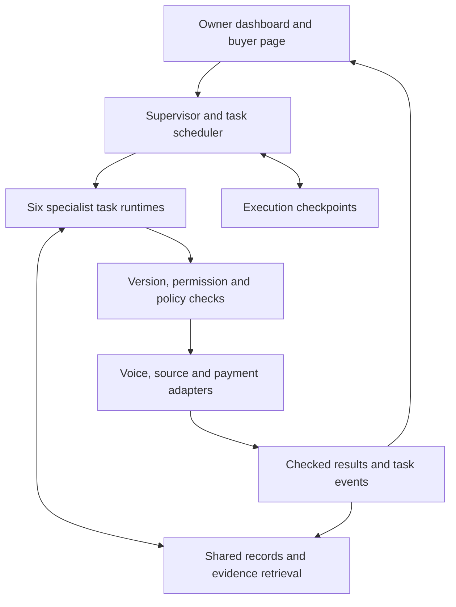

# Principal: Consolidated Product and Technical Context

**Version:** 1.0  
**Updated:** 16 October 2026, Asia/Jakarta  
**Status:** Accepted product direction, with a proposed implementation and hackathon scope. No application, trained model, customer validation or executed prototype tests are claimed.  
**Purpose:** Preserve the complete Principal idea, its development, evidence, architecture, business logic and next decisions so work can continue without reconstructing this conversation.

## 1. The idea

Principal is an AI business team that an independent professional directs and controls. It helps find suitable clients, promote services, communicate with prospects, manage relationships, coordinate commitments and collect payment. The freelancer supplies the expertise and performs the professional work.

The owner works through a dashboard of six cute, visible specialist subagents: **Scout, Promoter, Sales, Account Manager, Operations and Finance**. Each has its own tasks, context, permitted tools and output artifacts. Their named cursors and activity appear beside the records they are inspecting or updating. The owner can delegate a goal, inspect evidence, redirect an agent, pause work or approve an action.

Principal supports work obtained through direct relationships, referrals, communities, personal promotion and freelance marketplaces. It is not restricted to Upwork or Fiverr. International selling is central: an Indonesian owner can direct the team in Indonesian while a disclosed AI representative handles an English-speaking buyer through voice or text.

The strongest current product hypothesis is that the team can help a freelancer turn suitable opportunities into usable income while controlling acquisition spending, owner effort and commercial exposure. A qualified conversation, accepted contract, received deposit, earned revenue and completed project remain distinct events.

### Four-paragraph explanation

Independent professionals must sell their services, answer inquiries, organize commitments and manage payment alongside their professional work. Their information sits across posts, messages, portfolios, calendars, agreements and financial records. Our research identifies selected cases of acquisition spending without contracts, unsuitable assignments, unfavorable commercial conditions and difficult payment coordination.

Principal gives the freelancer a visible AI business team. Scout, Promoter, Sales, Account Manager, Operations and Finance work in a shared dashboard with individual characters, tasks and cursors. The owner sets the rules and controls decisions. The freelancer continues to deliver the creative, technical or other professional service.

The team connects relevant business information, retrieves source evidence and exchanges structured handoffs. It can prepare community promotion, qualify an English-speaking prospect, brief the owner in Indonesian, check capacity and payment terms, prepare an approved offer and track the resulting receipt. Specialists assess an opportunity together before making commitments. Backend rules control commercial and financial actions.

The intended impact is more suitable international opportunities, less avoidable administrative effort and fewer communication or payment mistakes. The hackathon would demonstrate one complete journey through all six agents, ending in a checked sandbox deposit and a recorded next client action. Real acquisition, earnings, retention and willingness to pay require subsequent user validation.

## 2. Decisions that must survive future simplification

| Decision | Current position |
|---|---|
| Product identity | A freelancer-owned AI business team with visible specialist delegation |
| Interface | Cute subagents, a shared dashboard, multiple named cursors, inspectable work and direct owner control |
| Genuine execution | Separate task-scoped agent runs with actual tools and outputs; activity follows execution events |
| Business breadth | Acquisition, promotion, sales, client relationships, operations and finance |
| Professional delivery | Performed by the freelancer; Principal does not produce the commissioned project |
| Client channels | Direct, informal, community, referral and marketplace work |
| International value | Find and assess overseas opportunities, communicate across languages and coordinate commercial/payment conditions |
| Voice | Natural, disclosed AI representation is a desired interaction; English buyer conversation and Indonesian owner briefing are the provisional first language pair |
| Technical ambition | Coordinated agents, evidence-linked retrieval, persistent shared state, bounded tools and verifiable completion |
| Hackathon reduction | Reduce connector count, supported tasks and automation depth before removing specialist roles |
| Evidence discipline | Separate source reports, interpretations, proposed capabilities and measured results |

The number six is the current organizing design. The user explicitly restored the subagent-team experience after an earlier feasibility draft compressed it into three broad roles. Future work should preserve meaningful business coverage and genuine delegation rather than silently returning to that compressed design.

## 3. How the concept developed

| Stage | What changed | What remains useful |
|---|---|---|
| Clearwork payment coordinator | Rejected as the overall proposition because invoice/payment administration lacked the desired ambition and interaction | Compatibility checks, evidence, approval invalidation and reconciliation remain useful inside Finance |
| Freelancer-owned AI agency | Established the goal of giving an individual a team for commercial decisions and resource use | Owner control, shared context and business-wide responsibility |
| Business operations boundary | User chose agents that run the business around the work | No autonomous execution of the client's creative/software project |
| Cute dashboard subagents | User proposed visible agents and numerous cursors, inspired by Dot and Google Stitch | Team presence and inspectable concurrent work are core interaction requirements |
| Existing-tool coordination | User cited YC Lance's work around existing hotel tools as inspiration | Consolidate information and act through existing services where access permits |
| International selling | Added overseas lead discovery, English communication, voice representation, retention and CRM | Cross-border commercial relationships are central, beyond FX display |
| Informal acquisition | Added self-promotion, community posts and direct clients | Support sellers without requiring a marketplace account |
| Pareto feasibility | Selected a complete community/request-to-deposit journey | Limit integration depth while maintaining the larger product vision |
| Team restoration | Replaced the three-role compression with six genuine specialists | All six contribute useful work in the proposed demonstration |
| Research-led refinement | Connected acquisition cost, skill fit, capacity, terms and collection | Specialists jointly assess opportunities and verify outcomes |

There is no verified URL or capability map for the user's Dot reference. Treat it as an interaction reference, not a technical dependency. Google Stitch, Lance and other benchmarks supply attributable patterns; they do not establish Principal's novelty or permission to reuse proprietary assets.

## 4. Customer, jobs and research support

### Initial customer hypothesis

An experienced Indonesian independent creative has credible portfolio work, some spare capacity and a desire for recurring overseas clients. They currently manage selling and administration themselves. A motion designer and an English-speaking US buyer form the provisional demo scenario. The user has not confirmed that profession, corridor or customer segment as a final launch choice.

Freelancing is the current focus. Gig-worker evidence informs net-work economics and reliable records, but the analysis does not establish that driving/delivery workers have the same international client-acquisition workflow. Do not merge those populations.

### Jobs to be done

- Present a service accurately in the right channel and respond to relevant buyer requests.
- Find opportunities that fit demonstrated skills, available time and commercial limits.
- Communicate confidently across languages without changing material terms.
- Coordinate scope, deadlines, buyer inputs, deposits and payment instructions.
- Preserve client history and prepare relevant follow-ups, referrals and repeat-work proposals.
- Know what has actually been agreed, paid, saved and completed.

### Evidence base and limits

The supplied analysis programmatically screened **83,523 canonical records**: **18,713 social records** and **64,810 Google Play reviews**. It closely reviewed **374 selected records**, including **194 Play reviews**. The other 180 reviewed records are social material. Purposeful selection, query routes, rating-targeted feeds, related comments and repeated observations prevent population-prevalence estimates.

Sources are `Financial_Experiences_Research.xlsx`, `Research_Corpus_Cleaned.xlsx` and `Google_Play_Reviews_Cleaned (1).xlsx`. The analysis workbook links findings to stable evidence IDs and source sheet/row references. These are reported experiences, not independently adjudicated incidents.

| Finding | Exact supporting observation | Product consequence | Boundary |
|---|---|---|---|
| Financial F09: acquisition exposure | E0166 and E0169 describe buying Upwork Connects without securing further work; E0020 describes paid Fiverr promotion/membership with little exposure | Scout and Promoter need budgets, fit checks and source-to-collected-payment attribution | No measured conversion rate, total acquisition cost or platform-wide misconduct |
| E0307: capability mismatch | An international writer describes winning copywriting work despite blog-writing experience, struggling to deliver and receiving a partial fee | Retrieve portfolio evidence at deliverable level; Sales must clarify missing capability before promising it | Self-promotional account; later success and payment amounts remain unverified |
| Financial F18: terms allocate exposure | E0292 describes work without an upfront payment followed by reported nonpayment; the author contrasts it with roughly ten earlier foreign clients without that experience | Check scope, milestones, cancellation and deposit before owner acceptance | One reported episode; no universal claim about foreign clients or legal enforceability |
| Financial F17: conditional cost and compatibility | E0276 reports a $25 sender-bank charge plus a $6.84 service fee on $500; E0250 describes SWIFT-only receiving details when the desired payout required US routing details | Ask about payer funding and recipient capabilities early; show documented and unknown costs | E0276 does not establish a corridor or a matched cheaper alternative; E0250's attempted alternative was blocked |
| Financial F08: verification burden | E0069 reports $496 recorded against $532 calculated manually; E0142/E0144 describe active tracking without saved records | Completion requires persisted, checked outputs; measure owner checking and repair effort | The $36 is a reporting discrepancy, not established lost earnings. These records do not all establish freelance identity |
| Financial F10: payment and documentation differ | E0289 describes US-client payments reaching Pakistan with unresolved remittance documentation/classification questions | Preserve matched agreement, invoice, receipt and bank evidence; expose missing documents | The source's tax and banking explanations are unverified. Country-specific implementation needs qualified local validation |

Raw navigation: Play `Upwork` rows 3 and 51; `Fiverr` row 89; `Gridwise` rows 17 and 96; `Stride` rows 55, 118 and 175. Social `X_Posts` row 2; `Reddit_Posts` rows 26, 900, 1001 and 1107. Stable evidence IDs in the analysis remain the primary cross-reference.

Keep counterevidence. E0197 reports a functioning USD/ACH-to-GBP route for that person's accounts. E0148 reports working mileage tracking alongside unwanted promotional notifications. E0268 initially questions an agency arrangement but later describes feeling fortunate about the contract. These examples weaken universal failure claims and support account-specific diagnosis, useful notification controls and an honest understanding of what intermediaries provide.

The reviewed evidence does **not** directly establish demand for cute characters, English voice agents, Facebook promotion, retention automation or Principal subscriptions. Those are product hypotheses or user preferences. Neither USD denomination nor an app's collection locale proves international work or residence.

## 5. The differentiating mechanism

Principal's proposed distinction is a **shared assessment of an opportunity before commitment**, followed by checked execution. The six agents contribute to one continuing business record.

| Specialist | Question it contributes |
|---|---|
| Scout | Which requested deliverables match actual portfolio evidence, and what is missing? |
| Promoter | Which channel produced this inquiry, and what money and owner effort did acquisition consume? |
| Sales | What does the buyer want, what remains unclear, and which proposed terms have they accepted? |
| Account Manager | What does the client history show, and which follow-up is appropriate? |
| Operations | Do current capacity, deadlines, dependencies and required buyer inputs fit? |
| Finance | What are the documented payment conditions, funding gap and estimated retained amount? |

An expensive-looking project can fail capability or capacity checks. A lower-priced scope can be more workable. A signed contract can leave collection unresolved. The owner sees those conditions and chooses the action; the system does not invent a probability of conversion or nonpayment.

Before an offer, distinguish verified facts, owner assumptions, estimates and missing prerequisites. After execution, distinguish activity from a saved output and an expected amount from a checked receipt. The interface should reduce the need to supervise every small action by showing exceptions and evidence.

This is a research-informed product hypothesis. The public review corpus does not establish global originality, competitor absence or a durable data advantage.

## 6. The six agents and their work

| Agent | Full product responsibility | One useful hackathon task |
|---|---|---|
| Scout | Discover opportunities from permitted sources, assess fit and explain gaps | Assess an imported request against portfolio evidence and return a sourced fit brief |
| Promoter | Position services, prepare campaigns and adapt posts to channel rules | Create an approved promotional post/response with an attributed buyer-page link |
| Sales | Represent the business, qualify inquiries and discuss permitted offers across languages | English browser voice/text qualification with a structured buyer brief and Indonesian owner recap |
| Account Manager | Maintain CRM, follow-ups, relationship history, referrals and repeat-work proposals | Update the checked client timeline and prepare an editable next-action draft |
| Operations | Coordinate capacity, deadlines, onboarding, buyer inputs and dependencies | Check the deadline/capacity and produce a client-input checklist |
| Finance | Evaluate prices, deposits, payment conditions and records | Produce feasible offer options, route approval, create a sandbox request and reconcile the receipt |

Each run receives a goal, scoped context, allowed tools, budgets and required output. It can choose useful tool steps, inspect results, ask for clarification or return a blocked outcome. Several roles may use the same foundation model. Their context, tools, state and artifacts remain distinct.

The supervisor dispatches tasks and routes structured handoffs. Independent Scout and Promoter work can happen concurrently. Sales waits for relevant Operations and Finance results before representing confirmed terms. Account Manager consumes accepted commitments and checked payment events.

## 7. Dashboard and interaction

The owner workspace combines a business overview, task board, shared artifact area, client timeline and agent dock. It shows available capacity, decisions awaiting attention, confirmed receipts and outstanding balances. Forecasts and estimates carry their own labels.

- Give every specialist a recognizable cute character, name and role label.
- Attach a named cursor or focus highlight to the artifact the agent is inspecting or changing.
- Show actual concurrent work in separate task workspaces. Agents should not fight over one shared browser tab.
- Click an agent to inspect its task, sources, tool outcomes, artifact, elapsed time and measured spending.
- Let the owner assign work, redirect a task, answer a clarification, pause or cancel.
- Link handoffs to the originating task, receiving agent and transferred output.
- Show `idle`, `working`, `waiting`, `review_needed`, `completed`, `blocked`, `failed` and `cancelled` states accurately.
- Preserve labels alongside color and offer reduced motion. Marketing notices should not obscure useful business events.

Cursor activity derives from actual task events. An API read can highlight a record without pretending to control a browser. Expose concise action explanations and execution traces rather than private chain-of-thought. Completion requires the appropriate persisted result, not an animation finishing.

The buyer page shows services, approved portfolio examples, a disclosed AI representative, voice/text entry, relevant proposed terms and payment status. Owner-private material remains private.

## 8. Acquisition, communication and retention

### Acquisition channels

Support explicit buyer requests, community self-promotion, owned portfolio inbound, referrals, agency overflow partnerships and repeat clients. Distinguish an actual request from an inferred need or generic business listing. Record source date, provenance, channel rules and permission.

Apify is a candidate adapter for authorized collection. Treg is a candidate research/lead-signal access route. Exa is an optional search/research provider. None confers permission to access private groups, proves buying intent or establishes a contact's willingness to receive outreach. No single data provider is mandatory.

For Facebook Groups, the hackathon prepares **approve, copy and open destination**. The owner publishes and can record the post URL. No supported automatic Groups publishing path was verified in the research; retain the documented API-deprecation limitation until a current supported route is established. A draft remains `ready_to_share` until publication is confirmed.

Use campaign links to attribute inquiries. A page view is not a qualified prospect, and a conversation is not a paying client. Attribute research, promotion and communication spending plus owner effort. Stop or ask for direction when a campaign reaches its budget without the agreed outcome.

### Bilingual representation and voice

The provisional interaction uses an English-speaking buyer and Indonesian owner. The representative draws on approved service claims, asks about deliverables, budget, timing and payment expectations, and requests backend-calculated options. It cannot invent portfolio results or promise arbitrary terms.

Natural voice is desired, with clear AI disclosure. Start with a live browser conversation and typed fallback. Inbound web voice and owner briefings are distinct from cold outbound calling or simultaneous interpretation inside third-party meetings. Those deeper integrations remain later work.

Preserve amount, currency, date, timezone, conditions and acceptance state across original transcript, English recap and Indonesian briefing. A tool must return a checked result before the representative announces success.

### Client management and retention

Maintain one client record with source, inquiries, agreements, preferences, payment events and next actions. Prepare grounded follow-ups and later repeat-service proposals from this history. Respect channel preferences and pauses. A post-deposit request for assets demonstrates onboarding continuity; it does not demonstrate customer retention or repeat revenue.

## 9. Proposed architecture

This is a recommended implementation, not an installed or tested stack. Final choices depend on builders' skills, usable accounts, quotas and budget.

| Layer | Proposed technology | Its actual purpose |
|---|---|---|
| Interface and application | Next.js, React, TypeScript | Owner dashboard, agent characters/cursors, buyer page, application routes |
| Agent coordination | LangGraph.js supervisor and six role subgraphs | Bounded runs, parallel tasks, typed handoffs, persistence, owner intervention and streaming |
| Language reasoning | One structured-output/tool-calling model provider, such as Claude | Extraction, clarification, evidence-based drafting and tool selection |
| Authoritative records | Supabase Postgres, Auth and private storage | Workspace isolation, client/business records, versioned offers, approvals, payment events and evidence |
| Retrieval | Postgres full-text plus pgvector when useful | Keyword/semantic retrieval with source IDs, dates, versions and visibility scope |
| Financial calculations | Typed TypeScript functions and decimal arithmetic | Enumerate permitted offers, check funding and reconcile receipts |
| Voice | ElevenLabs browser React SDK as the first candidate | Managed conversation with backend business tools and typed fallback |
| Event delivery | Server-sent events or equivalent | Drive factual task status, handoffs and artifact focus in the dashboard |
| Optional integration workflow | n8n | Connect existing services where it saves integration effort; business state remains authoritative in the application |
| Source adapters | User import in P0; one reviewed Apify/Treg/search route in P1 | Collect or import opportunities with provenance and permission |
| Payment adapter | Explicit financial sandbox in P0 | Request, pending/failure/success, receipt and duplicate-safe reconciliation |

Earlier Python/FastAPI/Pydantic/Docling suggestions belonged to Clearwork. They remain options if extraction requirements or team expertise justify them, but are not simultaneous requirements for Principal. Avoid building duplicate backend stacks without a concrete reason.

### Shared records and execution contracts

Logical concepts include workspace/profile versions, evidence, campaigns, opportunities, leads, engagements, conversations, requirements, offer versions, approvals, buyer acceptance, capacity reservations, fee/FX quotes, payment requests/events, ledger entries, follow-ups, agent tasks/runs and activity events. These do not require a microservice or separate table for every concept.

Each task/run stores agent ID, task ID, parent task, goal, input versions, scoped tools, budget, status, output references and event sequence. LangGraph checkpoints record execution progress; Postgres business records record commercial truth. Do not let a checkpoint or transcript overwrite an accepted agreement.

Suggested tools include `assess_opportunity_fit`, `retrieve_service_evidence`, `prepare_share_package`, `capture_inquiry`, `check_capacity`, `evaluate_offer_options`, `request_owner_review`, `accept_offer`, `create_sandbox_payment_request`, `inspect_payment_status`, `reconcile_payment` and `prepare_follow_up`.

Mutations receive authenticated workspace/engagement scope, validated typed inputs and current record versions. The execution gate checks authority, material approval version, freshness, recipient allowlist, budgets, capacity and idempotency. Agents cannot expand their own tools or grant approvals.

### Data states

Promotion: `draft → approved → ready_to_share → published_confirmed`, with paused/cancelled states.

Commercial: `inquiry → qualifying → offer_draft → owner_approved → buyer_accepted → payment_requested → deposit_pending → deposit_reconciled`, with declined, expired and unresolved states.

Work: `not_started`, `in_progress`, `owner_reported_delivered`, `buyer_accepted`. Payment never implies project completion.

Reserve capacity atomically when the buyer accepts a current offer. Reject a conflicting allocation. Release cancelled reservations or expired unpaid acceptance windows; preserve the allocation for active work after a reconciled deposit.

## 10. Advanced technology and the role of data

| Technique | Useful role | Current boundary |
|---|---|---|
| Multi-agent orchestration | Separate specialist goals/tools, concurrent research, structured cross-checks and owner control | Required product mechanism; do not claim superiority from agent count alone |
| RAG | Ground capability claims, promotion and client answers in the owner's portfolio, channel rules and client history | Retrieve with source/version/visibility metadata; retrieved text is not authorization |
| Hybrid retrieval/reranking | Improve matching when synonyms, exact services and specific deliverables all matter | Add a reranker only if retrieval evaluation shows a useful gain |
| Temporal memory | Preserve who said what, when, under which version, and which conclusions became stale | Start with versioned records; Graphiti/graph infrastructure is optional later |
| Constraint reasoning | Combine capacity, price, funding, route and owner limits | Enumerate two permitted packages in P0; an optimization solver is optional for larger scheduling problems |
| Voice AI | Interactive English qualification with Indonesian briefings and checked commercial tools | Browser voice first; no assumed outbound calling or universal language quality |
| Synthetic data | Create controlled missing-fact, deadline, fee, tool-failure and adversarial scenarios | Useful for evaluation and development; not evidence of real buyer behavior or revenue uplift |
| Outcome analytics | Trace acquisition source through qualified inquiry, agreement, collection and repeat work | Instrument actual events and costs; report missing and unresolved outcomes |
| Predictive ML | Later lead ranking or next-action models from consented operating outcomes | Public reviews do not supply dependable conversion, payment-default or retention labels |

The public corpus currently supplies a failure taxonomy and grounded scenario seeds. It is not a labeled sales-training dataset. No particular Kaggle dataset has been validated or selected in this conversation, and no model has been trained. GitHub repositories and literature are candidates to inspect for exact task fit, provenance, licenses and leakage before use.

If outcome modeling becomes justified, preserve source features at decision time, use a clearly defined outcome window and split by client/owner/time as appropriate. Keep development examples separate from held-out evaluation. Do not infer conversion probabilities, creditworthiness or fraud from complaint text.

## 11. Financial logic and reproducible synthetic example

Use integer minor units or decimal arithmetic. Preserve original currency and FX direction. Display documented fees, unknown fees, quote timestamps and expiry. A simulated quote is not an executable provider offer.

`estimated net local receipt = (gross foreign payment − applicable recipient fees) × local currency per foreign unit − documented local deductions`

`project contribution before acquisition = estimated net project receipts − delivery expenses − valued owner delivery time`

`engagement contribution after acquisition = project contribution before acquisition − attributable acquisition cash costs − valued owner selling time`

`upfront funding gap = required cash expenses before delivery − available net deposit − separately committed project cash`

Avoid counting fees or owner time twice. Unknown acquisition inputs remain unknown. Contribution is not accounting profit, and excludes taxes/fixed overhead unless explicitly included. A deposit creates a performance obligation; receiving it does not establish earned profit.

### Fixture inherited from the PRD

Every amount below is fictional. These are not current FX rates, provider fees or industry averages.

| Input | Full package | Reduced package |
|---|---:|---:|
| Deliverables | Four motion assets | Two motion assets |
| Price | USD 600 | USD 450 |
| Owner delivery effort | 18 hours | 12 hours |
| Earliest delivery | 10 business days | 5 business days |
| Required pre-delivery cash expense | IDR 3,000,000 | IDR 3,000,000 |

Other inputs: 12 hours available in the next five business days; buyer budget USD 500; owner delivery-time value IDR 150,000/hour; minimum contribution before acquisition IDR 1,500,000; deposit options 40% or 60%; simulated recipient fee 2%; simulated FX 15,000 IDR/USD; no other deductions or committed project cash. The expense represents a fixed fictional resource/license cost.

The full package fails the budget and five-day capacity constraints. The reduced package fits. Estimated full-project net receipts are USD 441, or IDR 6,615,000. Subtract IDR 3,000,000 expenses and IDR 1,800,000 valued delivery time to get IDR 1,815,000 contribution before acquisition.

A 40% deposit is USD 180 gross, USD 176.40 net and IDR 2,646,000. The funding gap is IDR 354,000. A 60% deposit is USD 270 gross, USD 264.60 net and IDR 3,969,000, which covers the stated expense. Principal proposes this option for owner approval and buyer acceptance.

The receipt allocates USD 270 gross to the invoice, records USD 5.40 fee and USD 264.60 net, and leaves USD 180 gross outstanding. Future receipts need their own quote. This fixture does not set acquisition costs to a measured zero or establish contribution after acquisition. Add explicit acquisition inputs before making that further claim.

A route check returns `satisfied`, `blocked` or `unknown`. Incompatible transfer types block a payment request. Missing prerequisites remain unknown. A successful prerequisite check does not guarantee provider approval or settlement.

## 12. Hackathon scope and demonstration

The proposed proof is:

**Community promotion or imported buyer request → qualified international conversation → jointly assessed offer → owner approval and buyer acceptance → reconciled sandbox deposit → recorded client next action.**

### Scope priorities

| Priority | Included capability |
|---|---|
| P0 | Six genuine specialists, one useful task per role, two concurrent independent runs, owner controls and factual dashboard events |
| P0 | Approved profile/portfolio, packages, commercial limits and available capacity |
| P0 | Imported request/community context, source-linked fit brief and promotion share package |
| P0 | Attributed buyer page, English browser voice with text fallback and Indonesian briefing |
| P0 | Joint capability/capacity/terms assessment, transparent acquisition fields and no invented conversion prediction |
| P0 | Correct offer calculation, material-version approval, buyer acceptance and atomic capacity reservation |
| P0 | Checked sandbox payment, receipt reconciliation, duplicate protection and remaining balance |
| P0 | Persistent relationship timeline and editable onboarding/follow-up action |
| P1 | One authorized live discovery adapter |
| P1 | One email/calendar connector or provider-specific payment test adapter, if account access is ready |
| P1 | A history-grounded repeat-engagement suggestion |
| Later | Broad autonomous discovery, supported social publishing, outbound telephony, deeper retention, multiple corridors and predictive learning |
| Excluded | Delivery of the freelancer's commissioned professional project |

### Proposed five-minute demo

| Time | On-screen action | Proof |
|---|---|---|
| 0:00–0:40 | Owner delegates a goal; Scout assesses a request while Promoter drafts a post | Two actual task runs, distinct cursors and sourced artifacts |
| 0:40–1:10 | Inspect outputs and approve an attributed share package | Owner control and honest assisted-publication state |
| 1:10–2:10 | Judge speaks as an English-speaking prospect | Grounded qualification, backend tool use and Indonesian recap |
| 2:10–3:20 | Buyer requests a five-day deadline and USD 500 budget; Sales requests Operations and Finance checks | Capability gaps/unknowns, capacity assessment and funding-based offer correction |
| 3:20–4:15 | Owner approves, buyer accepts and sandbox deposit completes | Bound offer version, capacity reservation, gross/fee/net amounts and checked receipt |
| 4:15–5:00 | Account Manager prepares the next action; change one material fact | All six roles contribute; approval becomes stale where appropriate |

Imported/synthetic requests, synthetic client history, simulated fee/FX and sandbox payments must be labeled. Use a real voice conversation if available, a clearly identified typed fallback if not. No real-money payment, public post or outbound message has been authorized by this planning work.

## 13. Security, reliability and evaluation

Enforce workspace and buyer visibility boundaries. Keep secrets server-side and issue scoped session credentials. Treat portfolio text, messages, web pages and transcripts as untrusted data. Embedded instructions cannot replace the beneficiary, change spending limits or approve a deal.

Bind owner approval to scope, price/currency, deposit, deadline, beneficiary, route and quote/version. Material changes invalidate dependent approvals. Tools validate typed data, record versions and authority. Check provider event signatures where relevant and deduplicate events. A timeout remains pending/failed until reconciled.

Bound run steps, tokens/cost, elapsed time, retries and destinations. Pause/cancel prevents further dispatch at safe boundaries; an already completed external effect requires its own recovery path. Do not treat deletion of a task card as reversal of a transaction.

All evaluations below are proposed, not executed:

| Check | Proposed acceptance evidence |
|---|---|
| Six-agent execution | One useful task/output per role, with two independent tasks running concurrently |
| Coordination | Sales waits for required capacity/finance results; stale input triggers rechecking |
| Grounding | 12 supported/unsupported portfolio questions with source support or explicit unknowns |
| Finance | At least eight independently calculated package/deposit/fee/capacity cases, including the fixture |
| Bilingual meaning | At least 12 paired utterances covering amounts, currency, timing, conditions and acceptance; no critical change in this test set |
| Authority | Reject stale approval, expired quote, beneficiary substitution and scope changes in specified cases |
| Source injection | At least five malicious snippets fail to expand authority or expose owner-private data |
| Persistence and completion | Read back important saved artifacts; interruption/refresh does not erase checked work or invent completion |
| Event reliability | Replaying a receipt produces no duplicate credit; repeated conversation events do not create duplicate engagements |
| Capacity concurrency | Conflicting simultaneous acceptances cannot allocate the same available hours |
| Route uncertainty | Blocked/unknown prerequisites cannot become a successful payment request |
| Channel truth | Copying is not publishing; a visit is not qualification; a deposit is not delivery |
| Owner effort | Record corrections, checking/repair time, clarifications and unresolved tasks |

Compare the same journey with a general chat assistant using identical profile/service facts plus manual quote/CRM handling. Compare source support, term preservation, constraint mistakes, owner interventions, completion and total cost. The baseline must receive the same facts. Report prototype results only after execution, with cases and limitations.

## 14. Sustainable business and differentiation

Potential customer value includes relevant acquisition, bilingual representation, reduced administrative effort, stronger relationship continuity and fewer avoidable commercial/payment errors. Willingness to delegate, buyer acceptance, retention and willingness to pay remain unknown.

Candidate monetization is an ongoing subscription plus transparent usage for costly research/voice. An optional fee on attributable newly collected business would require clear attribution and agreement. Do not automatically charge acquisition commission on pre-existing clients. No prices, margins, market size or revenue forecast are established.

Measure:

- Acquisition cash spending and owner selling time by channel and cohort.
- Qualified inquiries, accepted engagements and collected payments as separate outcomes.
- Contribution after delivery, acquisition and payment costs, with clear exclusions.
- Repeat paid engagements and repeat collected revenue within an explicit window.
- Principal's model, voice, data, infrastructure and variable servicing cost per successful task.
- Owner checking/repair effort, cancellations and unresolved work.

If there are zero paying clients, report spending and zero conversions instead of inventing an acquisition-cost ratio. A later learning asset would connect consented source, portfolio, conversation, terms, delivery acceptance, payment and repeat-work outcomes. Public contact lists and synthetic dialogues do not establish that asset.

Competition already overlaps individual capabilities: Leiko describes freelancer assistance; Artisan describes AI sales; HoneyBook covers client workflows; Reconciles covers reconciliation; Bonsai exposes business-tool integration; Wise supplies platform-specific payment capabilities. These are bounded vendor descriptions from research, not a complete competitor audit. Principal's proposed advantage must be demonstrated through its particular coordinated workflow and owner experience.

## 15. Competition context, workback and open decisions

The target is the **FinTechathon 2026 International AI Track**. The supplied event dossier records 40% task completion, 30% security/compliance and 30% innovation/interaction. Topic **C** is the provisional fit because the demo includes cross-border commercial/payment decisions; Topic **E** is an adjacent small-business-finance framing. The official entry topic remains unconfirmed. Choose one and verify the final scope against current rules.

The event snapshot records a 20 October 2026 deadline, conservatively **23:59 Beijing / 22:59 WIB / 15:59 UTC**. Website/brief differences and submission requirements remain unresolved in the master pack. The 16 October context update is not a fresh rules verification. Do not infer a fixed 48-hour onsite build window or mandatory sponsor stack from other tracks.

The provisional capacity assumption is two or three builders and roughly four focused days plus submission buffer. The user has not confirmed those inputs. Recalculate the workback from actual available hours and the current cutoff.

| Stage | Proposed exit condition |
|---|---|
| First integration stage | Basic team dashboard, bounded role runs, shared records and independently checked financial functions |
| Acquisition/conversation stage | Scout and Promoter work concurrently; buyer inquiry reaches shared state through text and voice |
| Commercial completion stage | Operations and Finance checks, owner approval, buyer acceptance, sandbox receipt and Account Manager next action |
| Evaluation/submission stage | Recovery/adversarial checks, baseline comparison, truthful demo, technical package and known issues |

Cut additional discovery/enrichment, extra providers, email/calendar connectors and deep retention before reducing the team experience. Simplify animation while preserving real role activity and owner controls. Use typed fallback if voice is unreliable and disclose the missing voice capability. Protect the complete journey, financial correctness and evidence.

Open decisions:

1. Actual builders, strengths, available hours and existing code.
2. First profession/service, credible portfolio and permissioned test material.
3. Selected official topic and final cross-border scenario.
4. Model, voice, database/hosting and optional source/payment accounts, quotas and total budget.
5. Supported source/channel access and whether a provider test adapter is ready.
6. Which buyer/owner participants can validate language and delegation quality.
7. Current organizer clarifications about submission artifacts, AI assistance, pre-existing work and identity documents.

No paid-user interviews, live outreach, production transactions, trained models or implemented agent runs are established by this context. The existing `Principal_PRD.md` v0.2 supplies an earlier detailed plan. This file incorporates the later research interpretation, explicit cute-team requirement and acquisition-cost distinction; use this consolidated context for those conflicts.

## 16. Sources and continuation instructions

### Local source provenance

| Source | Use |
|---|---|
| `FINTECHATHON_2026_INTERNATIONAL_MASTER_CONTEXT.md`, original 15 October snapshot | Competition dossier, conflicts, historical projects and operating methods |
| `Principal_PRD.md`, v0.2 | Six-agent requirements, scope, financial fixture, architecture, evaluation and workback |
| `Financial_Experiences_Research.xlsx` | Financial findings, hypotheses, evidence IDs, segment boundaries and review coverage |
| `Research_Corpus_Cleaned.xlsx` | Original social text and provenance |
| `Google_Play_Reviews_Cleaned (1).xlsx` | Original Play reviews and collection metadata |
| User discussion through 16 October 2026 | Product choices, rejected narrowing, interface references and accepted consolidation |

Financial F01–F18 refer to the financial-research workbook. The master competition dossier also has its own F-numbered ledger. These namespaces must not be merged.

### Previously inspected primary-source references

The links below support described mechanisms, not Principal's effectiveness or current account access. Most were inspected on 15–16 October during the preceding discussion; exact page revision dates are not established unless recorded in the original dossier. Refresh living documentation before implementation.

- [LangGraph.js overview](https://docs.langchain.com/oss/javascript/langgraph/overview): stateful orchestration, persistence, streaming and intervention.
- [Supabase hybrid search](https://supabase.com/docs/guides/ai/hybrid-search): full-text/semantic retrieval pattern.
- [ElevenLabs React SDK](https://elevenlabs.io/docs/eleven-agents/libraries/react) and [post-call webhooks](https://elevenlabs.io/docs/eleven-agents/workflows/post-call-webhooks): browser interaction, checked tools and conversation events.
- [ElevenLabs n8n integration](https://elevenlabs.io/agents/integrations/n8n) and [Apify n8n integration](https://docs.apify.com/integrations/n8n): optional connector patterns.
- [Treg repository](https://github.com/superdesigndev/treg) and [lead-signals recipe](https://github.com/superdesigndev/treg/blob/main/skills/lead-signals/SKILL.md): candidate research tooling, not proof of buying intent.
- [Exa agent quickstart](https://exa.ai/docs/agent/quickstart): optional research provider.
- [Meta Graph API v19 changelog](https://developers.facebook.com/docs/graph-api/changelog/version19.0/): Groups API deprecation. Prior official search excerpts were available; direct retrieval returned HTTP 429. No restored supported Groups publishing route was verified.
- [Wise recipient requirements](https://docs.wise.com/guides/product/send-money/recipients) and [quotes](https://docs.wise.com/guides/product/send-money/quotes): provider-specific prerequisites and quote concepts.
- [Stripe invoice testing](https://docs.stripe.com/invoicing/integration/testing) and [idempotency](https://docs.stripe.com/api/idempotent_requests): optional test adapter and duplicate-safe requests.
- [Google Stitch](https://blog.google/innovation-and-ai/models-and-research/google-labs/stitch-ai-ui-design/) and [updates](https://blog.google/innovation-and-ai/models-and-research/google-labs/stitch-updates/): interaction inspiration.
- [YC Lance](https://www.ycombinator.com/companies/lance): existing-tool coordination inspiration; company-described capabilities.
- [Graphiti](https://help.getzep.com/graphiti/getting-started/overview), [Sentence Transformers cross-encoders](https://sbert.net/docs/cross_encoder/training_overview.html) and [OR-Tools](https://developers.google.com/optimization/cp): optional later techniques, not installed components.
- [LiveKit workflows](https://docs.livekit.io/agents/logic/workflows/) and [Retell language support](https://docs.retellai.com/build/language-support): alternative voice approaches researched, not simultaneous requirements.
- [Leiko](https://leiko.ai/), [Artisan](https://www.artisan.co/ai-sales-agent), [HoneyBook](https://www.honeybook.com/), [Reconciles](https://reconciles.ai/) and [Bonsai documentation](https://docs.hellobonsai.com/): bounded competition context.
- [YC Abel](https://www.ycombinator.com/companies/abel-police): earlier inspiration for converting work evidence into administrative output; no claimed direct equivalence to Principal.

### Resume from this state

Treat Principal as the accepted direction. Preserve the six-agent dashboard and the boundary around professional delivery. Continue the user's next requested task using the actual team, accounts and available time. Ask only decision-changing questions, and do not repeat the entire discovery process.

Separate confirmed preferences from proposed defaults, reported incidents from verified effects, and planned features from implemented behavior. Do not claim that this planning document authorizes publishing, contacting prospects, spending money or moving funds. Do not collapse the product into a payment coordinator, a standalone sales bot or three generic dashboard roles without an explicit new user decision.
